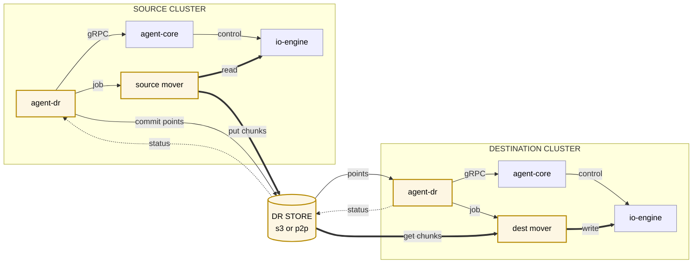
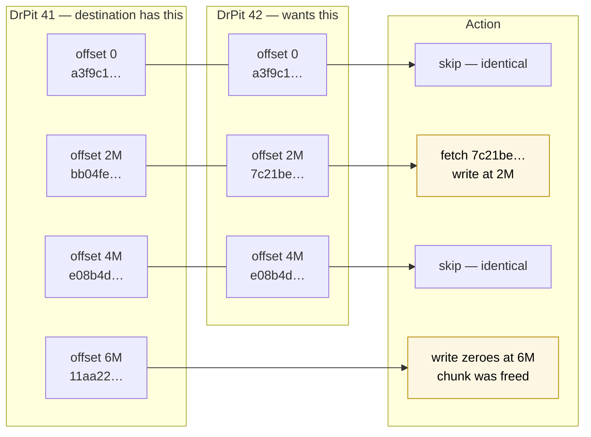
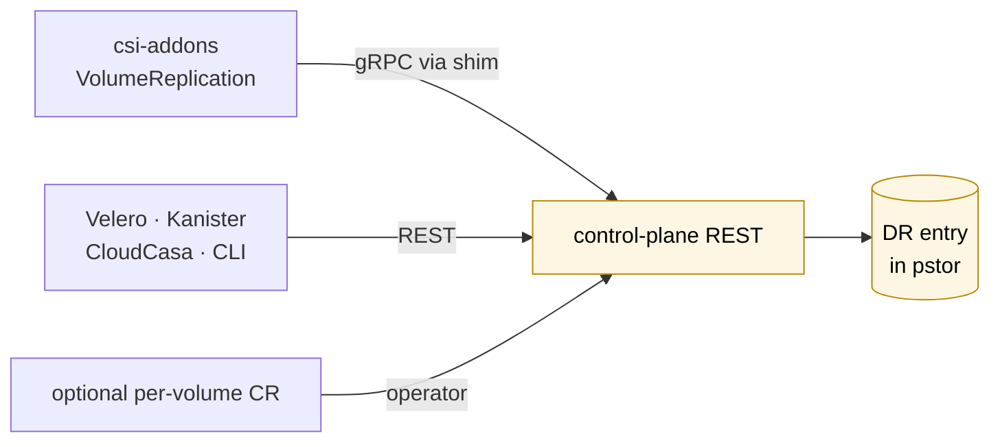
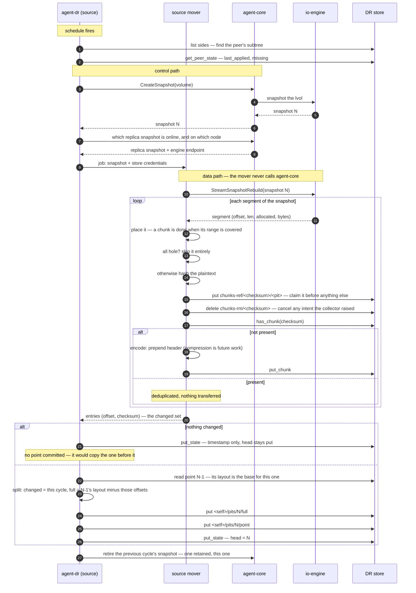
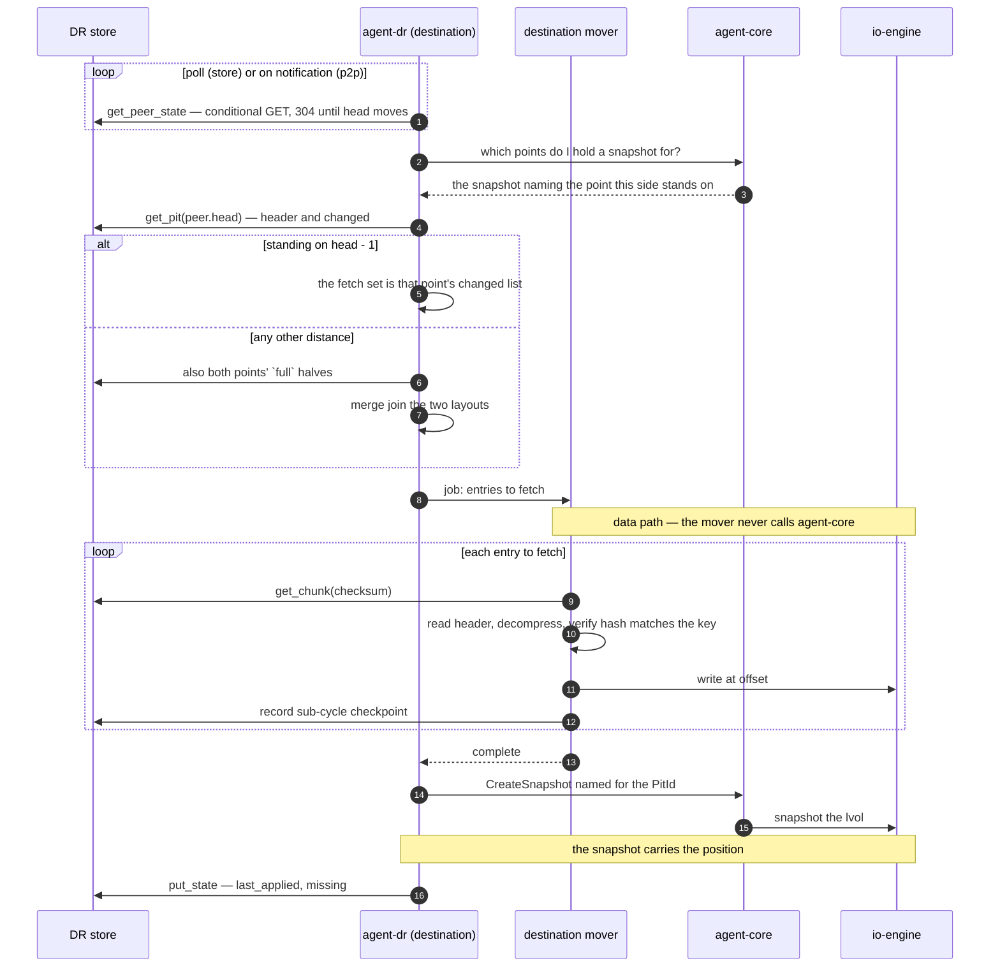
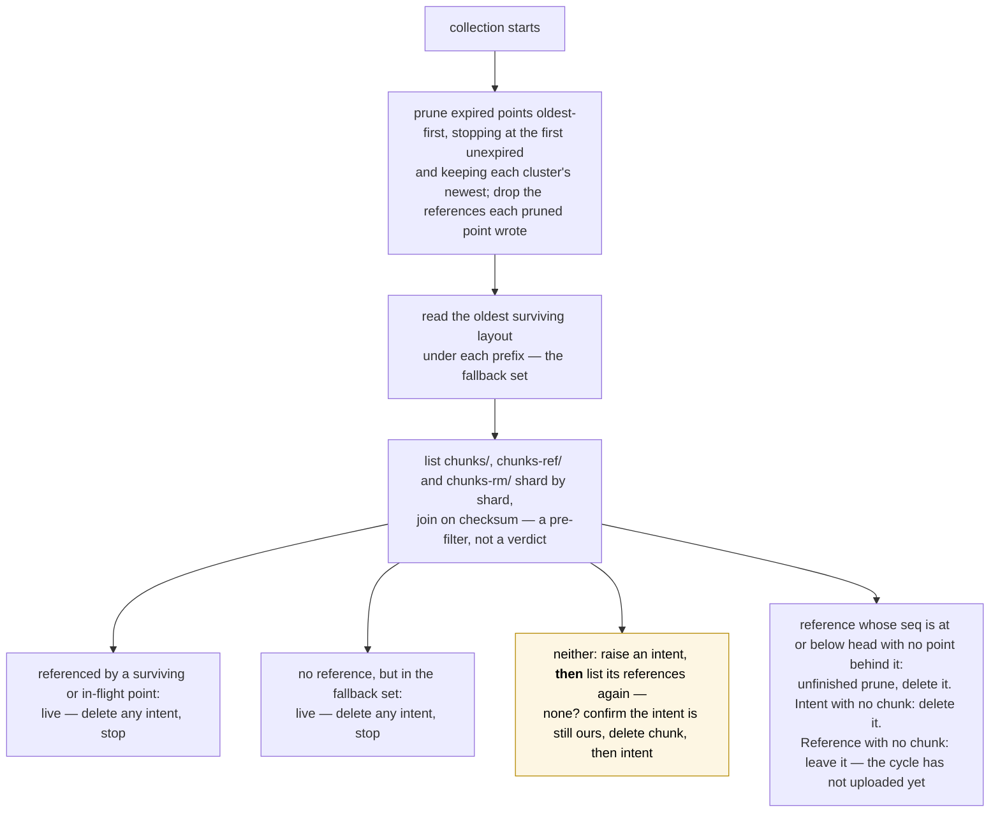
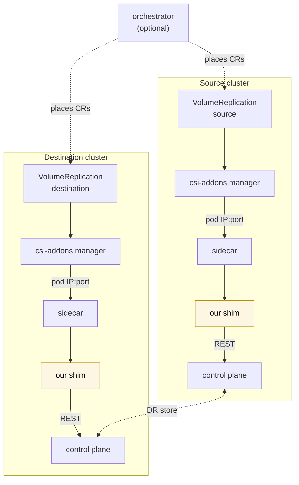
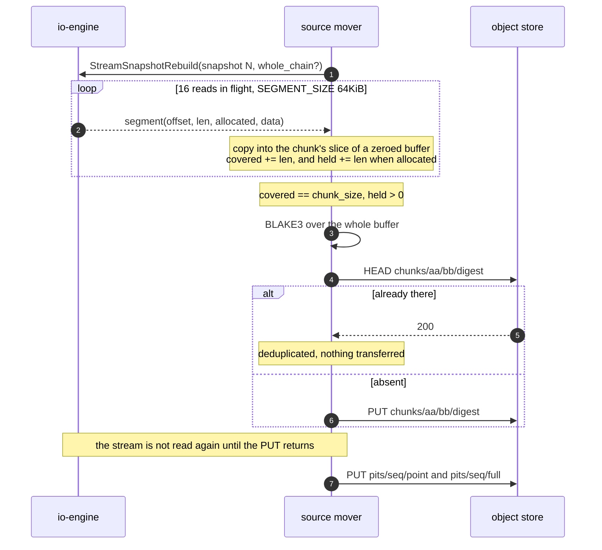
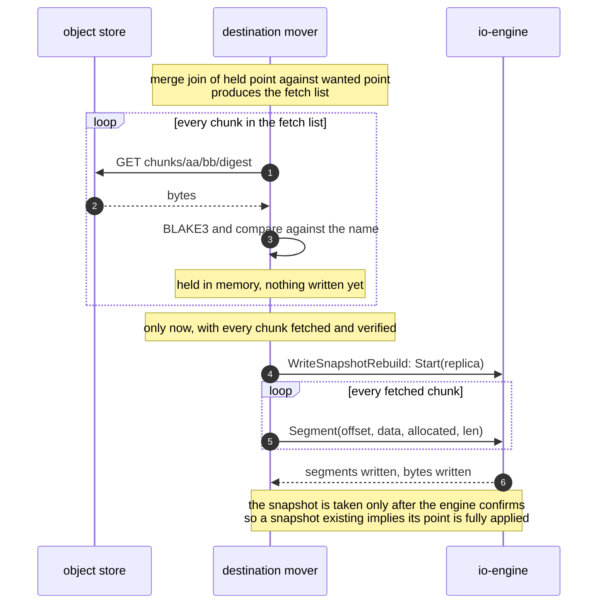

# Asynchronous Disaster Recovery for OpenEBS Mayastor

## Table of Contents

* [Summary](#summary)
* [Motivation](#motivation)
  * [Goals](#goals)
  * [Non-Goals](#non-goals)
* [Proposal](#proposal)
  * [Architecture](#architecture)
  * [Concepts](#concepts)
  * [The DR store](#the-dr-store)
  * [How convergence works](#how-convergence-works)
  * [The `DrStore` interface](#the-drstore-interface)
  * [Control-plane objects](#control-plane-objects)
  * [The replication cycle](#the-replication-cycle)
  * [Degradation and backpressure](#degradation-and-backpressure)
  * [Discovery](#discovery)
  * [Failover and failback](#failover-and-failback)
  * [Retention and garbage collection](#retention-and-garbage-collection)
  * [Integration with csi-addons](#integration-with-csi-addons)
  * [User Stories](#user-stories)
  * [Implementation Details](#implementation-details)
    * [Future improvements](#future-improvements)
  * [Risks and Mitigations](#risks-and-mitigations)
* [Graduation Criteria](#graduation-criteria)
* [Implementation History](#implementation-history)
* [Drawbacks](#drawbacks)
* [Alternatives](#alternatives)
* [Infrastructure Needed](#infrastructure-needed)

---

## Summary

This OEP proposes **asynchronous disaster recovery** for Mayastor: continuous,
incremental replication of a volume from one Kubernetes cluster to another, with
controlled failover and failback.

Replication is driven by a new control-plane agent, `agent-dr`, deployed on both
clusters. On a schedule, the source snapshots a protected volume, determines which
regions changed using the snapshot's allocation map, and copies only those regions to
a shared **DR store** — object storage today, with direct peer-to-peer behind the
same interface.
The destination discovers the new recovery point, applies the difference to
its own volume, snapshots to mark the position, and publishes its progress back
through the store.

The design has two defining properties:

- **Every recovery point is independently restorable.** A point records the complete
  layout of the volume at that instant, even though only changed data is uploaded. A
  destination can therefore converge from any point to any other in a single step,
  with no ordering constraints and nothing to replay in sequence. This is the default
  format; `IncrementalOnly` deliberately gives it up, and
  what that costs is set out under
  [two formats](#two-formats-and-whether-chunks-are-shared).
- **Data is addressed by content.** A chunk of volume data is stored under the hash
  of its own bytes, so identical data is stored once, transfers are skipped when the
  data is already present, and every download is verifiable on arrival.

Orchestration remains someone else's job. `agent-dr` exposes a control-plane API that
Velero, Kanister, Ramen, CloudCasa or an operator of our own can drive, and a
csi-addons shim makes Mayastor usable by anything speaking the standard
`VolumeReplication` API.

## Motivation

Mayastor replicates synchronously *within* a cluster: a volume's replicas live on
different nodes and every write lands on all of them. This protects against node and
disk failure. It does not protect against the loss of the cluster, the rack, or the
site.

Users running Mayastor in production ask for a second copy somewhere else, kept
reasonably current, that can be brought into service when the source is gone. That
is asynchronous DR: bounded data loss (an RPO measured in minutes) in exchange for
tolerating an arbitrarily distant, intermittently connected, bandwidth-constrained
destination.

Every DR orchestrator in the ecosystem delegates the data plane to the storage system.
They decide *when* to replicate and *what else* to move — Kubernetes objects, hooks,
scheduling — and then call the storage driver to move the bytes. Mayastor currently has
nothing to call. Whatever orchestration layer is eventually chosen, this engine is the
part that must exist.

### Goals

- Replicate a Mayastor volume to a second cluster, incrementally and on a schedule,
  transferring only data that has changed.
- Support a **store-mediated** topology over object storage that requires no network
  path between clusters and no firewall exceptions, and keep direct peer-to-peer
  available behind the same interface.
- Recover cheaply when the destination has been unreachable: catch-up cost must depend
  on how much data changed, not on how many cycles were missed - for as long as the
  points it needs are retained. Past that it pays for the volume, not for the absence;
  see [degradation and backpressure](#degradation-and-backpressure).
- Survive a destination that loses its data entirely, without requiring the source to
  re-upload the whole volume. Note what phase 1 does to the odds of needing this: the
  destination is created with **one replica**, not as a sizing decision but because
  convergence cannot fan a write out — so losing a single pool or node there is the
  whole copy, and this path answers an ordinary failure rather than a disaster. Writing
  through a nexus is what makes it rare again; see the convergence row in
  [risks](#risks-and-mitigations).
- Support planned failover, forced failover, and failback.
- Provide a control-plane API — REST and gRPC — usable by any orchestrator, and a
  csi-addons shim so Mayastor works with tools that speak `VolumeReplication`.
- Verify data integrity on arrival at the destination.

### Non-Goals

- **Synchronous or near-synchronous replication.** This is asynchronous DR with a
  bounded RPO, not a stretched cluster.
- **Orchestrating Kubernetes objects.** Moving PVCs, Deployments, ConfigMaps and
  Secrets between clusters belongs to a backup or DR orchestrator. This OEP covers
  volume data and the API to drive it.
- **Application-consistent snapshots.** Crash consistency is what the storage layer
  can offer. Quiescing an application before a snapshot is the orchestrator's job,
  through its own pre- and post-hooks.
- **Multi-volume consistency groups.** Snapshots are per-volume. Group support is
  discussed under [Risks](#risks-and-mitigations) and the API is shaped so it can be
  added without a breaking change, but it is not delivered here.
- **More than one destination per volume.** Fan-out to multiple DR sites is a natural
  extension and the store layout permits it, but a single relationship per volume is
  what this OEP specifies.
- **Replicating between volumes of different cluster sizes.** The chunk size is the
  source volume's, and the destination writes at the offsets the point names, so the
  two sides no longer have to agree for the copy to be *correct*. What they would not
  share is efficiency: a destination whose clusters are larger than the chunk
  allocates more than it receives. Discovery therefore still creates the destination to
  match, and bridging two sizes deliberately is out of scope; see
  [compression and integrity](#compression-and-integrity).

## Proposal

### Architecture

`agent-dr` is a new agent alongside `agent-core`, `agent-ha` and `agent-jsongrpc`. The
same binary runs on both clusters and behaves differently according to each volume's
role.



Thick edges are the **data path**, thin edges control, dotted the status channel. The
`DrClusterPair` operator is omitted for clarity — it reconciles the CRD onto the
control-plane REST API and does not sit in either path. Four things to note:

1. **Control and data are separate.** `agent-dr` calls `agent-core` over the existing
   internal gRPC to snapshot, clone, publish and create volumes. The movers never talk
   to `agent-core` at all — they read and write volume data against **io-engine**,
   over NVMe-oF or an attached block device.
2. **Nothing crosses at the Kubernetes layer.** Neither cluster holds credentials for
   the other's API server. The only cross-cluster path is the DR store.
3. **`agent-dr` never moves bytes.** It decides what to copy and hands a
   fully-specified job to a mover. This keeps the mover a dumb executor and lets the
   mover implementation change without renegotiating anything.
4. **The store is bidirectional but not symmetric.** The source writes data and
   recovery points; the destination writes only its own config and its status.

### Concepts

| Term | Meaning |
|---|---|
| **Chunk** | A fixed-size slice of a volume's address space, derived from the **volume's cluster size** and capped at 4 MiB: the cluster itself when it is no larger than the cap, and otherwise the largest even fraction of it that fits. 4 MiB is both the cap and the default cluster size (`DEFAULT_CLUSTER_SIZE`, `io-engine/src/lvs/lvs_store.rs:52`), so the two coincide by default. Fixed for the life of a relationship. The unit that is hashed, stored and transferred |
| **Segment** | The engine's unit on the wire: one read of a snapshot, 64 KiB (`SPDK_BDEV_LARGE_BUF_MAX_SIZE`), carrying either data or a hole. Distinct from a chunk, and the mover reassembles segments into chunks without relying on either dividing the other |
| **Checksum** | The digest of a chunk's *uncompressed* contents — BLAKE3, 256-bit, under the default `hashAlgorithm`. It names the contents rather than identifying them uniquely — see [the hash](#compression-and-integrity) — and is simultaneously the chunk's storage location and its integrity check |
| **DrPit** | A *DR point-in-time*: the complete layout of a volume at one instant, as a list of `(offset, checksum)` |
| **Relationship (`dr-id`)** | The pairing of a source volume with a destination volume, minted when DR is enabled. It outlives any particular direction |
| **DR store** | Where chunks and DrPits live. Object storage, or a peer `agent-dr` |

### The DR store

#### Layout

```text
<prefix>/dr/<dr-id>/
    chunks/<aa>/<bb>/<checksum>          content-addressed, immutable; the same bytes are the same key — `dedup: true` only
    chunks-ref/<aa>/<bb>/<checksum>/<side>.<uid>.<seq>  a pit that introduced the chunk: empty, written before the chunk is relied upon, removed when that pit is pruned
    chunks-rm/<aa>/<bb>/<checksum>       the collector's intent to delete the chunk: empty, raised by the collector, removed by any cycle that wants the chunk
    <side>/<cluster-uid>/dr.cfg                 this side's account of itself and of the relationship
    <side>/<cluster-uid>/state.json             this side's progress: head, what it has applied, what it could not
    <side>/<cluster-uid>/pits/<seq:016d>/point  a DrPit: its header, and the chunks that cycle changed
    <side>/<cluster-uid>/pits/<seq:016d>/chunks/<aa>/<bb>/<checksum>  the point's own chunks — `dedup: false` only
    <side>/<cluster-uid>/pits/<seq:016d>/full   the chunks that point did not change
<prefix>/clusters/<cluster>/<cluster-uid>/cluster.cfg    reserved: a per-cluster heartbeat, written only by its owner
```

**Each side writes only under its own subtree.** `<side>` is the end of the relationship
this cluster holds, named in its `DrClusterPair`; that CR is the handshake — it tells
each cluster the other's name. `<cluster-uid>` is the cluster's own identity, the same
one its control plane already keys its persistent store on: in Kubernetes the uid of the
`kube-system` namespace. Every key under `<side>/<cluster-uid>/` has exactly one writer,
so those writes need no precondition and nothing there is contended. `chunks/` is
shared only in the sense that both clusters put into the same pool: the key is the hash
of the content, so the same bytes are the same object and a second writer changes
nothing. Two sibling prefixes carry what the collector and the cycle have to tell each
other about a chunk, at the same shard and name as the chunk itself: a **reference**
under `chunks-ref/` naming a pit that introduced it, and the collector's **delete intent**
under `chunks-rm/`. A cycle writes its reference and then clears any intent; the
collector raises an intent and then looks for references. Neither needs a precondition — the
order they are touched in is what carries the guarantee, and it is set out under
[retention](#retention-and-garbage-collection).

**The two halves answer different questions, and both are needed.** The uid is what a
cluster *is* and cannot be chosen wrongly, so it keeps two clusters that were both named
`east` from colliding. The side name is which end of a relationship a cluster *holds*,
and it is what separates two sides that share a uid — which is every loopback, one
cluster standing in for both ends, and the ordinary way to exercise the protocol without
a second cluster. Neither alone is sufficient.

**There is no object both clusters write**, and therefore no compare-and-swap anywhere
in the steady state. Each side publishes its own `dr.cfg` under its own subtree, saying
who it is and what it believes; a side finds its peer by listing the configs under the
relationship and taking the one whose `uid` is not its own. The cost of this is that
facts requiring *agreement* — which cluster is source, the epoch, the garbage collection lease —
have nowhere to live; see [the relationship configuration](#the-relationship-configuration).
Credentials follow the layout, and a cluster holds two identities: the cycle and
convergence paths get `Put` on `<self>/` and `chunks/`, `Put` and `Delete` on
`chunks-ref/` and `chunks-rm/`, and read on the rest, with no `Delete` on `chunks/` or
`pits/`; the collector alone holds `Delete` there, from its own secret. The relationship
id sits outermost, so a grant is per relationship unless the resource pattern wildcards
`<dr-id>` and pins `<side>/<cluster-uid>`, which every major store's policy language
allows. The model is set out once, under
[a compromised cluster and the store](#a-compromised-cluster-and-the-store), and
every other mention of credentials in this document defers to it.

**Which end a volume holds is derived, not configured.** A pair names both ends and says
which one its own cluster holds, so that is the default and the only answer a
two-cluster deployment ever needs. Where another volume in the same relationship already
holds that end, the next takes the far one — which can happen only when one cluster
stands in for both sides, since a relationship has exactly one entry per control plane
and an agent can therefore contend only with itself. Deriving it rather than offering a
per-volume setting matters: the alternative is a knob that lets a cluster be told to
write under its peer's name, which is the one thing the layout exists to prevent.

The entry records the end it took, so it does not move under a volume once chosen.

Throughout the rest of this document `<self>/` and `<peer>/` are shorthand for the two
`<side>/<cluster-uid>/` subtrees. A side knows its own from its pair and its own
identity; it finds its peer's by listing the relationship and taking the config that
answers to the name its pair expects the peer under.

**Two documents carry everything the peer needs.** `<peer>/dr.cfg` says who the peer
is and where its subtree is; `<peer>/state.json` says how far it has got. The source
publishes the sequence of its newest point; the destination publishes what it has applied
and what it could not. Finding the peer costs one listing of the relationship, done
once; after that each side polls those two objects and nothing else — a `GET` each, or a
conditional `GET` on the ETag that returns 304 when nothing has changed.

Chunks are immutable, and a point is never rewritten once `head` has passed it. A
cycle uploads its chunks, *commits* by creating `<self>/pits/<seq>` with the complete
entry list, and only then advances `head` in its state; until the create succeeds the
point does not exist, and until the state is updated the peer does not look for it. A
point above `head` may be written again — by the retry of a cycle that crashed after
committing, or by [resume](#resuming-a-crashed-cycle) — because nothing has read it. There is no in-progress marker for the
*point* in the store — a point is either absent or complete. What a cycle does do as it
goes is claim every chunk it is about to name: a reference under `chunks-ref/` first,
then the removal of any delete intent. Both are facts about the chunk rather than about
the cycle, and they are what let garbage collection run at the same time.

The prefix is keyed on the **relationship**, not on either volume, so it does not move
when the direction of replication does. Each cluster's control plane maps its own
volume UUID to the `dr-id`; **the two volumes have different UUIDs**, because they are
distinct objects in distinct control planes.

That has a consequence for anything that carries a volume identity across clusters. A
PV's `volumeHandle` *is* the Mayastor volume UUID — the CSI controller derives it from
the PVC — so a PV restored on the destination by an orchestrator names the *source*
volume, and so does every csi-addons RPC issued against it. The DR entry therefore
records **both** UUIDs — its own volume and the peer's — and the REST API and the
csi-addons shim resolve a volume UUID they do not own through that mapping before
rejecting it. Each cluster's `state.json` carries its own volume UUID, so either side
can populate the mapping from the store alone. Creating the destination volume *with
the source's UUID* would make the mapping unnecessary and is worth evaluating; the
mapping is the design because it works whether or not that turns out to be possible.

The two sides share one prefix because that prefix *is* the communication channel.
Consistency is not at risk: the source writes `<self>/dr.cfg`, `<self>/pits/`,
`<self>/state.json` and `chunks/`; the destination writes `<self>/dr.cfg` and
`<self>/state.json`; and neither writes anything the other does.

#### The relationship configuration

```rust
/// `<side>/<cluster-uid>/dr.cfg`. One per side, written only by the side it describes,
/// so it needs no precondition and can never be contended.
struct DrConfig {
    version: u32,           // schema version, so a later reader can tell an absent field
                            // from an older agent that never wrote one
    dr: DrId,
    cluster: ClusterId,     // the end of the relationship this side holds
    uid: ClusterUid,        // this cluster's own identity
    peer: ClusterId,        // the end it expects to find the other under
    volume: VolumeId,       // this side's volume — populates the peer mapping
    role: Role,             // what this side believes it is
    cluster_size: u64,      // the volume's geometry — what a matching volume is built from
    chunk_size: u64,        // derived from cluster_size; the unit this side's points use
    upload_format: UploadFormat,  // what a point carries beyond its own changes
    dedup: bool,                  // false puts each point's chunks under its own prefix
    hash: HashAlgorithm,          // the function whose digest names a chunk
}

enum HashAlgorithm {
    /// 32-byte names, `2^128` against collisions. The default.
    Blake3,
    /// 64-byte names, `2^256` against collisions, at 1.8x the point metadata. Not a
    /// wider BLAKE3 - the digest length is mixed into the IV, which is the thing that
    /// moves the bound. BLAKE3 cannot reach `2^256` at any output length.
    Blake2b512,
}

enum UploadFormat {
    /// A point carries only what its cycle changed, and there is no base anywhere:
    /// the store holds the last `ttl` worth of changes rather than a copy.
    IncrementalOnly,
    /// The same, plus `full`: the entries the cycle carried forward, so every point is
    /// the whole layout. Assembled from the previous point and this cycle's delta
    /// without re-reading the volume - a synthetic full, taken every point rather than
    /// on a schedule.
    SyntheticFull,
}
```

A side writes this when it joins, and finds its peer by listing the configs under
`<prefix>/dr/<dr-id>/` and taking the one whose `cluster` is the name its pair expects
the peer under. **Named rather than deduced**: taking "whichever side is not us" is
correct only while there are exactly two configs, and a volume re-targeted away from a
relationship and back leaves one behind under its old subtree that would then be
selectable. Matching the expected name also makes a misconfigured pair visible, instead
of converging against whatever happened to be there.

The cluster uid is not configured and not invented here. `agent-dr` asks the core agent
for it — a `GetClusterInfo` on the registry service — so it is by construction the same
identity the control plane already keys its own persistent store on, rather than a
second opinion about which cluster this is. Core is a hard dependency for it, and
nothing orders the two agents, so the call is retried rather than fatal: there is
nothing useful to do without the answer and nothing harmful about waiting for it.

**This is a departure from one shared `dr.cfg` written by both clusters under
compare-and-swap, and it is not free.** What it buys is that the design has no
conditional write at all: every object has exactly one writer, which matters because
conditional writes are the one store capability that cannot be assumed — the Garage
instance used for development accepts `If-Match` and does not enforce it, which is worse
than refusing it. What it costs is that the facts the two clusters must *agree* on no
longer have a home:

| Fact | Was | Now |
|---|---|---|
| Which cluster is source | `dr.cfg.source`, settled by CAS | each side's own belief, in its own config; nothing arbitrates |
| The epoch a point was committed under | `dr.cfg.epoch`, raised by promotion | carried on each `DrPit`, but nothing raises it |
| Who is running garbage collection | `dr.cfg.gc_lease` | nowhere |

That is tolerable only while there is exactly one source by construction, which holds
until promotion exists. **Nothing in the store can arbitrate, so the design does not ask
it to: there is no automatic failover.** Promotion is an operator action with an
out-of-band interlock — honest, and much less useful. It needs nothing the store cannot
guarantee and nothing the design does not already have. Retention is left in the same
position: no fence, so which cluster may collect is the interlock's business, or it goes
away structurally under `dedup: false` or per-side chunk ownership.

Both of the automatic alternatives are set out under [alternatives](#alternatives). The
shorter of the two reasons is that one depends on a store capability that fails
silently, and the other decides without fencing.

**How a superseded source finds out, with no shared object.** It reads the other side
and takes the later lineage as the truth — which is what [coming
back](#story-4--coming-back) describes, and what the `epoch` carried on every point is
for. That ordering **detects**; it does not **arbitrate**. Two sides that both believe
they are source at the same epoch still need a tie-break, which is exactly what the
out-of-band interlock is there to prevent rather than resolve. Two consequences follow:
something has to raise the epoch on promotion, which nothing does today, and the epoch
has to live in the per-side record rather than only on each point.

> **A role is a belief.** Each cluster's DR entry carries a `role`, and its `state.json`
> and `dr.cfg` echo it, but none of them is authoritative: they record what that cluster
> *currently believes*. Under the shared-config design `dr.cfg` was the fact that settled
> it. There is no such fact now, so two clusters that both believe they are source would
> both act on it — which is the precise reason the layout cannot carry failover yet.
> See [forced failover and split-brain](#forced-failover-and-split-brain).

#### A cluster's state

```rust
/// `<side>/<cluster-uid>/state.json`. The one object a side rewrites; the peer reads it.
struct ClusterState {
    version: u32,                 // as in DrConfig
    cluster: ClusterId,
    dr: DrId,
    volume: VolumeId,             // this cluster's volume — populates the peer mapping
    role: Role,                   // Source | Destination | Resyncing — what this cluster believes; nothing decides
    epoch: u64,                   // raised only by a promotion; what orders two lineages
                                  // when both sides believe they are source. Nothing
                                  // raises it today; reserved so something can
    drained: Option<Timestamp>,   // set when a quiesce stops the volume taking writes,
                                  // cleared by the next cycle. What lets a destination
                                  // tell "idle at N" from "quiesced at N". Not yet set

    // as source
    head: Option<u64>,            // sequence of the newest point under <self>/pits/
    head_at: Option<Timestamp>,   // when it was committed

    // as destination
    last_applied: Option<PitId>,  // None until the first point is applied
    applied_at: Option<Timestamp>,// when it was applied
    cycle: Option<CycleProgress>, // the in-flight convergence, if any
    /// Entries the destination could not apply — a 404 or a hash mismatch on the
    /// chunk. The source treats these offsets as changed in its next cycle; see
    /// retention and garbage collection for why the report is necessary.
    missing: Vec<ChunkRef>,

    observed_at: Timestamp,       // when this was written
}
```

**The two timestamps are what make a lag answerable.** Points are committed on a
schedule, so how far a destination is behind is a question about time, not about a count
of points: a sequence number says the gap is three points, which could be thirty seconds
or a day. The source subtracts the destination's `applied_at` from its own `head_at`; a
destination that has applied the newest point is not behind at all. Both fields are
optional, so a side that has written neither is reported as unknown rather than guessed
at — an unknown lag is honest, and a fabricated one reads as progress.

#### A DrPit

```rust
/// Names a point: the cluster that wrote it and its sequence under that cluster.
struct PitId {
    writer: ClusterId,
    seq: u64,
}

/// `<self>/pits/<seq:016d>/point`.
struct DrPit {
    id: PitId,
    dr: DrId,                 // the relationship
    epoch: u64,               // the writer's epoch when it committed this point
    volume_size: u64,         // grows on resize; the destination grows to match
    chunk_size: u64,          // derived from the volume's cluster size; the writer's unit
    allocated: u64,           // bytes this point's chunks cover, as against volume_size
    carried: u64,             // how many chunks the `full` half holds
    snapshot: SnapshotId,     // the volume snapshot this point was taken from
    replica_snapshot: Uuid,   // the replica snapshot actually read
    /// Sorted by offset: what the cycle that produced this point changed.
    changed: Vec<ChunkRef>,
}

struct ChunkRef {
    offset: u64,
    checksum: Hash,   // names the stored object
}
```

##### Two formats, and whether chunks are shared

> **`SyntheticFull` with `dedup: true` is the phase 1 format.** The other two are
> specified now because they change the store's shape rather than extend it, and
> retrofitting a format onto a bucket that already holds points is the one migration
> this design cannot do. All four combinations can be stepped through in the
> [animated walkthrough](./async-disaster-recovery/dr-flow.html), which is where the
> difference in what the store ends up holding is easiest to see.

What a point contains, and where its chunks live, are two choices with one constraint
between them. Both belong to the relationship rather than to a volume: the source
publishes them in `dr.cfg` and a destination that cannot serve them refuses the
relationship outright, exactly as it refuses a mismatched `chunk_size`. Half-applying a
format is worse than not replicating.

**Both formats upload only what changed.** The names describe what a *point* carries,
never what the cycle transfers — a cycle moves the chunks its snapshot allocated and
nothing more, in either format. What `SyntheticFull` adds is the `full` object: a list
of the entries the cycle carried forward, which is metadata, not data.

**The names are the backup industry's, and one of them is exact.** A *synthetic full* is
a full assembled from an existing chain rather than from the source — only changed data
is written and everything unchanged is referenced from the previous backup — which is
precisely what `changed` plus `full` is. The difference from the products is cadence:
they synthesise a full periodically, every point here is one.

`IncrementalOnly` has no equivalent, and that is worth knowing rather than glossing. Of
the four chain types a backup product offers — forward incremental, forever forward
incremental, synthetic full, reverse incremental — **every one keeps a full**, which is
what makes it a backup. `IncrementalOnly` deliberately does not, which is why it cannot
restore without the source. Its nearest relative is a replication *journal*: a bounded
window of changes with the replica, not the repository, holding the state. `Only` is
doing real work in that name — an "incremental" with no qualifier would imply a base
somewhere, as it does in all four.

**`uploadFormat`** decides what a point carries beyond its own changes:

- **`SyntheticFull`** — `changed` plus `full`, the whole layout. The newest point
  therefore names every allocated chunk, so the store always holds a complete copy of
  the volume.
- **`IncrementalOnly`** — `changed` only. The store holds the last `ttl` worth of
  changes and nothing else, so it is a channel rather than a copy.

**`dedup`** decides whether chunks are shared:

- **`true`** — the pool at `chunks/`, keyed by content. The same bytes are one object
  however many points and whichever cluster name them.
- **`false`** — `<side>/<uid>/pits/<seq>/chunks/<aa>/<bb>/<checksum>`, under the point
  that introduced them. Nothing is shared, nothing is checked for presence, and a
  chunk's location is implied by the point that names it rather than looked up.

**The constraint: `dedup: false` requires `IncrementalOnly`.** A standalone point names
the whole volume, so chunks under its own prefix would mean a full physical copy per
point — ten retained points of a 10TiB volume is 100TiB — and the alternative, letting
`full` reference chunks under *other* points' prefixes, shares them again and brings
back everything sharing costs. Three combinations are therefore valid and the fourth is
excluded:

| `uploadFormat` | `dedup` | the store is | reclaiming space is | chunks retained¹ |
|---|---|---|---|---|
| `SyntheticFull` | `true` | a recoverable copy | references, fallback layouts, and intents | ~10.9 TiB |
| `IncrementalOnly` | `true` | a window of changes | references alone, and they are authoritative | ~1.05 TiB |
| `IncrementalOnly` | `false` | a window, sharing nothing | deleting the point's prefix | ~1.05 TiB, more when content repeats |
| `SyntheticFull` | `false` | — | — | **excluded**: a full copy per point |

¹ 10TiB allocated, 4MiB chunks, 1% churn per cycle, ten retained points.

**What each one gives up.** `SyntheticFull` is the only one whose bucket survives losing
both clusters, and the only one that can restore *to* a past point rather than follow
forward from the present. `IncrementalOnly` gives that up for an order of magnitude less
chunk storage and a point that is a megabyte instead of a hundred — which also removes
the per-cycle rewrite of the whole layout that [risks](#risks-and-mitigations) lists as
a standing exposure. `dedup: false` gives up content collapsing — the repeating-pattern
case that turns 68MiB into two objects stops happening, and the first full cycle pays
the volume's true size — in exchange for a chunk lifetime that needs no reasoning at
all.

**A destination that has lost its position has to ask.** Under `SyntheticFull` this
needs nothing: a side with no snapshot diffs against the current head from nothing,
every chunk differs, and the result is a full restore *out of the store* — which works
because the store holds a copy. Under `IncrementalOnly` there is nothing to diff
against, so the destination must get a base from the source, and the only channel
between them is the store.

It already exists. The destination publishes the request in its `state.json`, which the
source reads every cycle to fill in the peer report, and which already carries a
`Resyncing` state for this condition. The source's next cycle then reads the whole
volume rather than the snapshot's own allocation and commits a point whose `changed`
list is the entire layout. That switch is the `whole_chain` flag the cycle already has —
in phase 1 it is set by `previous.is_none()`, "I have nothing to build on", and a destination
with no position is the same condition seen from the other end. So the mechanism is a
field in `ClusterState` and a second reason to set a flag, not a new protocol.

**The base is an ordinary point and ages out like one.** It names every allocated chunk,
so while it is retained the storage saving is gone — and the tempting fix, pruning it
the moment the destination has applied it, would make the destination's progress govern
retention, which [the rule above](#retention-and-garbage-collection) exists to prevent.
It is left alone instead: the base expires under its `ttl` like anything else, and a
destination that did not manage to apply it in time asks again. Redo, not a special
case.

**Catch-up under `IncrementalOnly` is still a union, not a replay.** A destination *n*
points behind reads deltas *N+1…M*, merges them keeping the newest entry per offset, and
fetches that union; it does not apply them one at a time. The warning under [how
convergence works](#how-convergence-works) is about applying a sequence, not about
reading one. What `IncrementalOnly` does lose is the floor: once the destination falls
outside the retained window there is no point to diff against, and recovery is a full
re-upload from the source rather than a larger join.

Under `SyntheticFull` a DrPit names **every allocated chunk**, not only the ones its own
cycle changed — while still uploading only the changed ones. That combination is what
makes each point independently restorable and transfers incremental at the same time,
and it is the reason the rest of this section describes two objects rather than one.
`IncrementalOnly` keeps the second half and drops the first: a point names its own
changes and nothing else, so the entry list *is* the delta. Nothing in the store then
describes the whole volume, which is the trade recorded
[above](#two-formats-and-whether-chunks-are-shared) — the complete picture exists only
on a destination that has already applied everything older.

> The entry list is **state, not history**. It describes the volume *as of this
> point*, so a chunk that was written earlier and has since been trimmed is absent.
> Accumulating "everything ever changed" would resurrect freed data on a full rebuild
> and defeat thin provisioning.

**The list is split across two objects**, and the division is what the cycle changed
against what it did not:

| Object | Holds | Read by |
|---|---|---|
| `pits/<seq>/point` | the header above, and the chunks that cycle changed | everyone |
| `pits/<seq>/full` | every chunk the point did *not* change, carried from the point before — `SyntheticFull` only | a convergence across more than one point, and a restore |

The two are **disjoint**: `full` completes the point rather than repeating it, so a
cycle that rewrote the whole volume lists every chunk once in `point` and writes no
`full` at all. Their union, in offset order, is the whole volume. An absent `full` is
therefore already a legal state, which is what `IncrementalOnly` reuses: every point
reports `carried: 0` and writes only its header and `changed`. The difference is that
the union is then not the whole volume and is not claimed to be.

This replaces a `changed` flag on each entry, which said the same thing but only after
the entire list had been decoded. A destination exactly one point behind — the steady
state — now reads one small object and nothing else, because the difference between
consecutive points *is* the newer one's `changed` list. At 10 TiB with 1% of the volume
moving per cycle that is 1.4 MB rather than the 280 MB that joining two whole layouts
costs.

Both halves sit under the point's own prefix rather than beside it: `pits/` is listed to
find the newest point and the sequence is zero-padded so that listing is chronological,
so a suffix on the point's key would have sorted a point's second half between it and
the next point.

**Neither list is JSON.** Each entry is a fixed-width binary record — an 8 byte offset
and the hash, so 40 bytes at the default 256-bit width and 72 at 512 — because the list
is the only part of a point whose size follows the volume. As JSON an entry costs about 119 bytes against 40 packed, which at 10 TiB
and 4 MiB chunks is 312 MB against 105 MB, written every cycle and read by every
convergence that is not consecutive. `changed` is base64'd to sit inside the header's
JSON; `full` is its own object and so is written raw, which is the third that base64
would otherwise add. The header stays plain JSON, since it is a fixed handful of fields
at any scale and is the half anyone reads by hand.

`allocated` and `carried` are in that header so the size and shape of `full` are known
before deciding to fetch it — and so that a `full` which is absent or the wrong length
is an error rather than something to read as an empty list, which would silently hand
back a layout missing most of the volume.

> A debugging switch (`--json-chunks`, or `DR_JSON_CHUNKS`) writes both lists as
> plain JSON instead, at roughly three times the size. Reading never depends on it: a
> packed list is a JSON string and a readable one an array, and `full` is distinguished
> by a leading `[`, which is unambiguous because a packed list begins with the low byte
> of a chunk-aligned offset and is therefore always zero. A store may hold both forms
> at once.

#### Addressing

A chunk's location is **computed from its checksum**, never looked up:

```text
s3://<bucket>/<prefix>/dr/<dr-id>/chunks/<c[0..2]>/<c[2..4]>/<checksum>
                                         └ two-level fan-out, 65536 shards ┘
```

Bucket and prefix come from the `DrClusterPair`, the `dr-id` from the local DR entry,
and the rest from the checksum itself. So `(dr-id, checksum)` yields an exact key with
no index and no round trip.

Note what is **not** in the path: the offset. The checksum says *what the bytes are*;
the DrPit entry says *where they go*. Identical content at different offsets, or in
different points, is one object.

**Why the address is computed rather than recorded.** Naming an object by its contents
collapses four problems that an allocated-name scheme has to solve separately:

- **Writes are idempotent.** Re-uploading a chunk writes the same bytes to the same
  key, so a cycle interrupted halfway has nothing to roll back and a retry is free. No
  two writers can disagree about a key, because agreeing on the content *is* agreeing
  on the key.
- **Deduplication is a property of the namespace**, not a pass that runs over it. Data
  rewritten with the same contents, moved between offsets, or shared between points, is
  already there — the cycle finds out with an existence check, not a comparison.
- **Verification is intrinsic.** The destination re-hashes what it downloads and
  compares against the name it asked for, so a truncated transfer or a corrupted object
  is caught before it reaches a replica. A recorded name would need a checksum stored
  beside it, and something to keep the two in step.
- **There is no index.** `(dr-id, checksum)` is the key, so nothing has to be looked
  up, kept consistent with the data, or recovered when it disagrees.

This is the bargain git makes — objects are named by the hash of their contents and
never mutated — and the one OCI registries make, where blobs are addressed
`sha256:<digest>` and a manifest is a list of digests rather than of filenames. What it
costs is that nothing can be edited in place: every change is a new object, and
reclaiming space becomes a reachability question rather than an overwrite, which is why
retention is garbage collection over what the surviving points reference.

**Why the prefix.** The leading four hex digits of the checksum name a shard, split
across two levels so the fan-out at each is 256 — 65,536 shards, about 40 chunks each
for a fully allocated 10 TiB volume at 4 MiB chunks. Three things improve with it:

- **Request rate.** S3 scales throughput per prefix, and its own guidance is to
  [distribute requests across multiple prefixes](https://docs.aws.amazon.com/AmazonS3/latest/userguide/optimizing-performance-design-patterns.html#optimizing-performance-high-request-rate)
  rather than let a sequential or shared one become the unit of contention. A flat
  namespace caps what a mover can drive however much concurrency it is given.
- **Backing stores that are filesystems.** S3-compatible implementations commonly map
  keys onto directories, and a single directory holding millions of entries degrades on
  most filesystems.
- **Listing.** `LIST` is paginated, so a collection pass over a flat namespace is inherently
  serial; sharded, it is 65,536 independent listings that can run in parallel.

**Sharding on the leading digits of a content hash is an established pattern**, and the
reason given for it is usually the second point above rather than the first:

- Git splays loose objects over 256 subdirectories named by the first two characters of
  the object id. [The documented rationale](https://git-scm.com/docs/gitrepository-layout)
  is "to keep the number of directory entries in `objects` itself to a manageable number".
- Restic files pack files at `data/<first two hex digits>/<sha-256>`
  ([repository layout](https://restic.readthedocs.io/en/stable/100_references.html)).
- Two levels of two digits is equally common — `objects/ab/cd/abcd1234…` in
  [content-addressed records](https://www.knowledgefutures.org/updates/2026-06-08-content-addressed-records/),
  and `chunks/sha256/aa/bb/aabb<rest>.chk` in
  [pg_hardstorage](https://docs.pghardstorage.org/explanation/content-addressed-storage/),
  which gives the clearest reason for the depth: the split "is sized so the directory
  fan-out at each level caps at 256 — object stores hate wide listings, and this layout
  caps the per-prefix LIST cost even at very large scale".

Depth and width differ between them; what does not is cutting the shard from the hash.
Two levels of two is the choice here, for the reason pg_hardstorage gives: it keeps the
fan-out at *each* level to 256 while still giving 65,536 shards. A single level of four
digits reaches the same shard count with a shorter key, but puts 65,536 entries under
one prefix — more than a delimited `LIST` returns in a page, and close enough to the
historical ext4 64,000-subdirectory limit to be unwise on a filesystem-backed store.
Width is a constant (`PREFIX_DIGITS`); depth is the part that would be awkward to
change later, which is the argument for taking the conventional one.

That last part is the one worth being deliberate about, because the alternative is
tempting and wrong. Nixpkgs shards a plain source tree the same way —
`pkgs/by-name/<first two characters>/<package>/`, so that twenty thousand packages are
not twenty thousand directory entries — but it shards on the **name**, and names are
not uniformly distributed. Its busiest prefix, `li`, holds 1,134 of 20,666 packages
against a mean of 28, about 41x, while many hold one. That is harmless for a tree a
human navigates and unacceptable for a key a store load-balances on. A checksum has no
such structure: the same item count spread over hash prefixes lands within a few
percent of the mean. **The shard is even because it is cut from the hash**, not because
of how many there are.

Sharding is a response to the backing store and the object count rather than something
content addressing requires — a store that shards internally, or a small enough
relationship, would not need it. It costs nothing to keep when it is not needed.

#### Compression and integrity

**The checksum is over uncompressed data.** If it were over the compressed form, the
address would depend on the codec and level: identical data compressed two ways would
get two names, deduplication would break, and the codec could never change without
orphaning everything.

Compression is therefore an encoding applied *beneath* the address, and each stored
object says how it was encoded:

```text
chunks/<aa>/<bb>/<checksum>
  ┌────────┬─────┬──────┬───────────┬─────────┐
  │ magic  │ ver │ algo │ plain_len │ payload │
  └────────┴─────┴──────┴───────────┴─────────┘
```

Four consequences worth stating:

- **Changing codec needs no migration.** The key is the plaintext hash, so an existing
  object is found and skipped whatever its encoding. Old chunks keep theirs forever;
  new ones use the new codec.
- **Changing the *hash* is the opposite, and is effectively permanent.** The same
  property that frees the codec binds the hash: the key *is* the digest, so a different
  function renames every chunk at once. An existing bucket would deduplicate against
  nothing, the next cycle would upload the whole volume, and the old objects would be
  unreachable until their points aged out. There is no in-place migration — only a new
  relationship under a new prefix. Whatever a relationship is created with is the hash
  that bucket keeps, which is why the choice is a field in `dr.cfg` rather than a
  constant in the binary.
- **`none` is a first-class algorithm.** Already-compressed or encrypted payloads do
  not shrink; the source measures and stores raw rather than spending CPU to grow the
  object.
- **Verification is free.** Because the name *is* the hash, the destination re-hashes
  everything it downloads. Store corruption and truncated transfers are detected
  rather than silently applied.

> **Phase 1 writes every chunk with `algo: none`.** The header is present from the
> first release, but no codec is part of it. This is deliberate: compression is pure
> CPU on the source, which is already the heavier side, and deferring it removes a
> tuning problem from the initial release without costing anything later — precisely
> because the header makes adopting a codec a no-migration change. See
> [Future improvements](#future-improvements).

**The chunk size is derived from the volume's cluster size, capped at 4 MiB.**
Allocation is tracked per *cluster*, so a chunk that lies inside one cluster is
either all data or all hole, and nothing is uploaded that the volume did not allocate.
That property holds exactly when the chunk size divides the cluster size, so the rule
is: the largest divisor of the cluster size that is at most `MAX_CHUNK_SIZE` (4 MiB).
A 1 MiB cluster gets 1 MiB chunks, 3 MiB gets 3 MiB, 8 MiB and 32 MiB and 1 GiB all
get 4 MiB. Cluster sizes are multiples of 1 MiB up to 1 GiB
(`Lvs::create_from_args_inner`), which is the only shape this has to tile.

The cap is a deliberate choice, not just a safety limit. A 32 MiB chunk would mean
32 MiB objects and a 32 MiB dedup unit, so a change anywhere in a cluster would
re-upload all of it. At 4 MiB the cluster splits into eight independently addressed
pieces and the ones whose contents did not actually change deduplicate against what is
already stored. The cost of the cap is that a larger cluster no longer reduces object
count — the count follows the chunk, not the cluster — which is why
[risks](#risks-and-mitigations) lists object count as a standing exposure rather than
something an operator can tune away by choosing bigger clusters.

Mayastor already requires every replica pool of a volume to share one cluster size, and
the scheduler enforces it, so the value is taken from the *volume* rather than from
whichever pool a replica happens to sit on: it is fixed at creation and cannot drift as
replicas move. Both the side's `dr.cfg` and every DrPit record the resulting
`chunk_size` from that same input, so a point cannot disagree with the unit its
relationship advertises, and the destination refuses a point whose `chunk_size` is
not the one the source published.

`dr.cfg` records the **cluster size as well as** the chunk size, because the
derivation is lossy in exactly the direction discovery has to read it: every cluster at
or above the cap yields a 4 MiB chunk, so 8 MiB, 32 MiB and 1 GiB clusters are
indistinguishable from the unit alone. A side applying points needs the unit; a side
*building a volume to match* needs the geometry. Stating both rather than inferring one
also means a later change to the derivation rule cannot retroactively reinterpret what
an existing relationship meant. Discovery creates the destination volume with
`cluster_size` pinned to the source's — `CreateVolumeBody` accepts it and restricts
placement to matching pools — so a failover does not change the chunk size either.

**The cluster is the floor on *read* amplification; the chunk is the floor on
*upload*.** A snapshot records change at cluster granularity — a 4 KiB write into an
untouched cluster copies and allocates the whole cluster — so no sub-cluster change
information exists to exploit, and the cycle must read and hash every byte of a changed
cluster to find out what moved. What it *uploads*, though, is per chunk: when the
chunk is smaller than the cluster, the pieces whose contents are unchanged
deduplicate and never leave the cluster. A workload with scattered small writes still
uploads many times what it wrote, and this is inherent to the mechanism rather than a
tuning problem — compression ([future improvements](#future-improvements)) shrinks the
bytes but not the count. It is listed under [risks](#risks-and-mitigations).

The hash, by contrast, is a deliberate choice: **BLAKE3**, 256-bit, un-truncated. A
collision means silently serving the wrong bytes, which is the worst failure available
to a DR system, and the 32 bytes per entry are noise against 4 MiB payloads.

Measured over a 4 MiB buffer, single-threaded, on a CPU that has SHA-256 in hardware
and no SHA-512 extension — the case least favourable to BLAKE3 and most favourable to
SHA-256:

| | throughput | per 4 MiB chunk | digest | collision resistance |
|---|---|---|---|---|
| **BLAKE3** | **4.22 GiB/s** | **0.93 ms** | 32 B | `2^128` |
| BLAKE2bp-512 | 2.89 GiB/s | 1.35 ms | 64 B | `2^256` |
| SHA-256 | 1.95 GiB/s | 2.00 ms | 32 B | `2^128` |
| BLAKE2b-512 | 1.33 GiB/s | 2.94 ms | 64 B | `2^256` |
| SHA-512/256 | 0.61 GiB/s | 6.40 ms | 32 B | `2^128` |
| SHA-512 | 0.60 GiB/s | 6.51 ms | 64 B | `2^256` |
| BLAKE2s-256 | 0.58 GiB/s | 6.74 ms | 32 B | `2^128` |
| SHA3-512 | 0.24 GiB/s | 16.28 ms | 64 B | `2^256` |

Two cautions on reading it. The 512-bit rows are **different functions, not wider
versions of the same one**: BLAKE2b mixes the digest length into its IV, so its 64-byte
output is not its 32-byte output extended — verified, the two do not share a prefix —
and BLAKE2bp is a four-lane tree over BLAKE2b that produces a different digest again.
And the numbers are implementation as much as algorithm: SHA-256 and BLAKE3 dispatch at
run time into hand-written `sha_ni` and AVX2, so `-C target-cpu=native` does not move
them, while the portable code gains up to 22%. The ordering is the same either way.

BLAKE3 is the fastest at equal width, and it parallelises *within* one chunk if a
backfill ever wants to spend the cores — 29 GiB/s across sixteen threads on the same
machine, which sizing should not assume, because those cores are also serving the data
path. The widely repeated claim that SHA-512 is faster on 64-bit hardware predates the
SHA-256 instructions that every current server part has; it is now backwards.

**What 256 bits does and does not mean.** A 4 MiB chunk has `2^33554432` possible
contents and there are `2^256` names, so the hash cannot be injective and was never
claimed to be: every name has on the order of `2^33554176` preimages. The property
relied on is cryptographic, not combinatorial — that nobody can *find* two chunks
sharing a name. Collision probability also goes as the square of the item count, not
the item size, so smaller chunks would make it worse rather than better: at 64 KiB a
fully-allocated 10 TiB volume holds 4096 times as many chunks, and its point metadata
would be 6.71 GB instead of 105 MB.

**This is exactly SHA-256's collision resistance, not less.** A 256-bit digest caps at
`2^128` against collisions by the birthday bound whatever the function computing it, so
SHA-256 and BLAKE3 at 256 bits are equal on the property that matters here and differ
only in speed. A 256-bit hash never gave `2^256`.

**Extending BLAKE3's output would not buy margin.** It has one security level at every
output length, because the chaining value stays 256 bits; asking it for 64 bytes yields
more keystream, not more strength, and the first 32 bytes come back byte-identical to
the 32-byte digest — verified rather than assumed. The reference implementation states
the rule directly: an N-bit BLAKE3 output provides N bits of first and second preimage
resistance and N/2 bits of collision resistance for any N up to 256, and *longer outputs
don't provide any additional security*. At N = 256 those are SHA-256's numbers on both
axes, which is worth saying plainly because "128-bit" and "256-bit hash" describe the
same function — the birthday bound halves the exponent for every hash there is.

**Going wider is a metadata decision, not a speed one.** A genuinely wider hash does
exist and is not slow: `2^256` needs a wider chaining value, which BLAKE2b-512 has, and
its four-lane sibling BLAKE2bp-512 delivers at 2.89 GiB/s — *faster than SHA-256*. So
the argument against 64-byte names is not throughput. It is that the name is the key and
the key is in every entry: 8 bytes of offset plus 64 of hash is a 72 byte record against
40, so a 10 TiB point's layout goes from 105 MB to 189 MB, written every cycle under
`SyntheticFull`, read by every convergence that is not consecutive, and unmigratable
once a bucket holds points. What that buys is a move from `3e-65` to `3e-142` on a
quantity already tens of orders of magnitude below the chance the medium corrupts the
bytes instead. 256 bits is chosen on that arithmetic rather than on speed, and the
option to decide otherwise per relationship is kept rather than closed off.

**So the hash is a third creation-time knob.** `hashAlgorithm` sits in `dr.cfg` beside
`uploadFormat` and `dedup`, for the same reason they are there: it decides the shape of
the keys in a bucket, so it is agreed when the relationship is created and cannot be
changed afterwards. `Blake3` is the default and the phase 1 value; `Blake2b512` is
specified for a deployment that wants `2^256` and accepts 189 MB per 10 TiB point to
have it.

Almost nothing else in the design has to care which was chosen. The fan-out cuts the
same two bytes from a 64-character name as from a 32-character one, `chunks/` is scoped
per `dr-id` so no two relationships ever need to agree, and a mismatch is already
handled — a destination that cannot serve the source's published settings refuses the
relationship rather than half-applying it. One thing it does add: **the point header has
to name the algorithm**, because `carried` is a count and the length check that turns a
truncated `full` into an error needs the record width, which is a constant today. The
cost of carrying both is a second path through the hottest loop in the cycle and a
doubled test matrix, for a margin nobody has asked for — which is why the second value
is specified here and left out of phase 1.

### How convergence works

This is the core of the design, so it is worth walking through concretely.

The destination holds DrPit 41. The source has committed DrPit 42. Converging is a
**merge join over two sorted lists**:



Two small documents are read; **one 4 MiB chunk is transferred**. The rest of the
volume is already correct and is never touched.

Three properties fall out of this, and they are the reason for the format:

**Any two points can be joined directly.** Because each list is absolute rather than
relative, going from point 41 to point 91 is the same single merge join as 41 to 42 —
it simply yields a larger result. A destination that has been unreachable for a week
pays for *what changed*, not for *how many cycles it missed*.

**There is no ordering requirement.** Nothing must be replayed in sequence, so there
are no sequence gaps to detect and no in-order application to enforce. The sequence
number in the key exists only so that "latest" is answerable by listing.

**One point behind is answered without the join at all.** It is the steady state, and
the point's `changed` half already *is* the difference against the point before it, so
neither layout is read. Any other distance falls back to the merge join — and that
fallback is not only about correctness. Replaying a gap of *n* points applies the sum of
*n* changed sets where the join applies their union, so a hot working set would be
written over and over; at 4 MiB a chunk that swamps any metadata saving by the second
point. Consecutive replay is the fast path, not the general strategy.

**Freed space propagates for free.** The fourth row above — an offset present in the
old list and absent from the new — means the chunk was trimmed, and the diff emits a
zero write. Holes are distinguished from zeroes structurally rather than by carrying
extra metadata.

> **Not in phase 1.** The phase 1 cycle reads what its snapshot's own blob allocated,
> which answers "changed since the parent" and "trimmed since the parent" identically —
> both are simply absent. A point therefore carries every offset the previous point
> had, an offset never leaves a layout, the fourth row never occurs, and freed space
> does not reach the destination. The convergence computes the freed set anyway and
> reports it, so once the source can express a trim the destination is already asking
> the right question.
>
> Separating the two needs the snapshot's allocation map rather than its delta. The
> engine reserves a request field for exactly that — a bitmap whose set bits are the
> allocated chunks, fetched by an `nvme-admin` command — but does not serve one, and
> rejects a supplied one. That is the work this depends on.

And because each point lists everything, **a destination that has lost its data can
restore from any single surviving point**, downloading only what it does not already
have. The source is not involved.

**Volume growth propagates through `volume_size`.** A resized source simply has a
longer allocation map, and the entries beyond the old size are new, so they appear as
changed. Before applying a point the destination compares its `volume_size` with its
own volume and **grows the volume first** when the point is larger, so a point is never
applied to a volume too small to hold it. Mayastor does not shrink volumes, so a point
*smaller* than the destination volume is an error rather than a resize.

### The `DrStore` interface

Everything above `DrStore` is unaware of the transport. The methods are concrete
operations, grouped so the caller is evident:

```rust
#[async_trait]
trait DrStore {
    // ---- identity: each side writes its own, and finds the peer by listing ----
    async fn put_cfg(&self, dr: &DrId, cfg: &DrConfig) -> Result<()>;               // PUT <self>/dr.cfg
    async fn get_cfg(&self, dr: &DrId, side: &Side) -> Result<Option<DrConfig>>;
    async fn list_sides(&self, dr: &DrId) -> Result<Vec<DrConfig>>;                 // the peer is the one named by the pair
    async fn list_relationships(&self) -> Result<Vec<DrId>>;                        // what discovery walks; nothing else lists

    // ---- the state documents: each cluster writes its own, reads the peer's ----
    async fn put_state(&self, dr: &DrId, s: &ClusterState) -> Result<()>;           // PUT <self>/state.json
    async fn get_state(&self, dr: &DrId, side: &Side) -> Result<Option<ClusterState>>;

    // ---- written by the source ----
    /// Writes this pit's reference under `chunks-ref/`, deletes any intent under
    /// `chunks-rm/`, and only then asks whether the chunk exists. The order is the
    /// guarantee: the reference must be durable before the intent is touched, and the
    /// intent gone before the answer is relied upon. See retention.
    async fn has_chunk(&self, dr: &DrId, pit: &PitId, hash: &Hash) -> Result<bool>;
    async fn put_chunk(&self, dr: &DrId, hash: &Hash, data: Bytes) -> Result<()>;
    /// Writes `full` and then `point`, and writes no `full` when `carried` is empty.
    async fn commit_pit(&self, dr: &DrId, pit: &DrPit, carried: &[ChunkRef]) -> Result<()>;
    async fn delete_pit(&self, dr: &DrId, id: &PitId) -> Result<()>;                // both halves; the collector's, phase 2

    // ---- read by the destination ----
    async fn get_pit(&self, dr: &DrId, id: &PitId) -> Result<Option<DrPit>>;        // header and changed
    /// Both halves merged. Errors rather than guessing if `full` is the wrong length,
    /// or absent while `carried > 0` — read as empty it would return a layout missing
    /// most of the volume. Absent with `carried == 0` is the legal no-`full` case.
    async fn get_pit_layout(&self, dr: &DrId, id: &PitId) -> Result<Option<Vec<ChunkRef>>>;
    async fn get_chunk(&self, dr: &DrId, hash: &Hash) -> Result<Bytes>;
}
```

**There is no conditional write.** `put_cfg` was the one operation that needed a
compare-and-swap and no longer does, since each side writes only its own config. What
that costs is set out under [the relationship
configuration](#the-relationship-configuration).

One document is all either side *polls*: the peer's `ClusterState`, which answers, for
the destination, "is there a new point?" (`head` moved) and, for the source, "what did
the destination make of my last point?" (`last_applied`, `missing`). The peer's
`dr.cfg` is read once, to find which subtree that is.

Two implementations sit behind the trait:

| | `s3` | `p2p` |
|---|---|---|
| Transport | HTTPS to an object store | gRPC to the peer `agent-dr` |
| Firewall between clusters | **none required** | required |
| Freshness of status | poll interval | immediate |
| Storage cost | a bucket | none |
| Phase | 1 | 4 |

`s3` is the design target. `p2p` is simply *"the peer is the store"* — the same trait
served by the counterpart's `agent-dr` from its own volumes, with no object store
involved. It trades the firewall exception for lower latency and no bucket to pay for,
and nothing above the trait changes. Should one of the shared-object options under
[the relationship configuration](#the-relationship-configuration) ever be revisited,
its compare-and-swap would be a mutex around one struct on the serving side.

The trait exists so that this remains a deployment choice rather than an architectural
one. Other object stores — GCS, Azure Blob — are the same implementation with a
different client.

> **Where this abstraction can leak:** latency. A `p2p` `get_state` answers in
> microseconds; the `s3` one is only as fresh as the peer's last publish plus the poll
> interval. No consumer may assume promptness, which is why `ClusterState` carries
> `observed_at` and why the volume's DR state includes an explicit `Unknown`.

#### One document per side keeps listing off the hot path

**`LIST` is the expensive operation and the design avoids it in every repeated path.**
It is billed with the PUT-class requests — roughly 12.5x a GET on S3 — has higher and
more variable latency because it is served from the metadata index rather than the
object path, and is where prefix-level throttling appears first.

So nothing is discovered by listing in the steady state. Each side reads `dr.cfg` and
the other's `state.json`, and everything else it needs is a key it can construct from
those two documents:

| Repeated question | How it is answered | Cost |
|---|---|---|
| Either: where is the peer's subtree? | `LIST` the relationship once, then `GET <peer>/dr.cfg` | not repeated |
| Destination: is there a new point? | `GET <peer>/state.json` — `head` moved | one GET, 304 when unchanged |
| Destination: fetch it | `GET <peer>/pits/<head>/point`, and both points' `/full` halves only when more than one point behind | one GET, usually |
| Source: what did the destination report? | the same `GET <peer>/state.json` — `last_applied`, `missing` | the same request |
| Source: what is the next point number? | its own `head`, plus one | free |

Listing appears in exactly two places, both off the hot path:

- **Discovery**, enumerating relationships the destination has not seen. New
  relationships are rare, so this runs on its own slow timer rather than per
  convergence poll.
- **Garbage collection**, which must enumerate chunks by definition. It is
  scheduled, infrequent, and already the expensive operation.

#### Object storage semantics relied upon

- **`PUT` and `GET` of whole objects**, with read-after-write consistency: once a
  `PUT` has returned, a `GET` of that key from anywhere sees it.
- **Atomic overwrite of a single object.** `state.json` and `dr.cfg` are rewritten; a
  reader sees the old document or the new one, never a mix.
- **Conditional `PUT`** (`If-Match: <etag>`, `If-None-Match: *`), evaluated atomically
  so that two concurrent writers with the same ETag produce one success and one `412`.
  **Not required by the per-side layout** — every object has one writer — but it is
  what promotion and the garbage collection lease would have needed under the rejected
  shared-object arbitration set out under [alternatives](#alternatives), and it is the
  capability that
  cannot simply be assumed: Garage accepts `If-Match` and does not enforce it, which is
  worse than refusing it, so anything built on this has to probe first and refuse to
  arbitrate when the answer is no.
- **Conditional `DELETE`** (`If-Match: <etag>`, `412` on mismatch). **Required**, and
  the only hard store requirement this design adds beyond plain verbs. It is what
  [retention](#retention-and-garbage-collection) uses to close the window between a
  collector deciding a chunk is unreferenced and removing it; without it that window
  admits a committed point naming a chunk that is gone, which is unrecoverable once the
  source is unavailable — the case disaster recovery exists for.
- **Multipart upload**, used by a cycle to re-upload a contended chunk so its ETag
  moves without its content changing. A multipart ETag is the digest of the part
  digests with the part count appended, so it is structurally distinct from the
  single-`PUT` digest of identical bytes. A single-part upload is legal at any size,
  since the floor applies only to parts that are not last.
- **Conditional `GET`** (`If-None-Match: <etag>`), so polling an unchanged document
  costs a 304 rather than a transfer. An optimisation, not a requirement.
- **Listing a prefix**, off the hot path as above.

Nothing else. No server-side locking and no transactions: every key has exactly one
writer, so there is nothing to guard. Conditional `PUT` is listed because it is now
common to the stores this design targets, which is what makes the shared-object option
for failover available:

| Store | Conditional `PUT` | Conditional `DELETE` |
|---|---|---|
| AWS S3, general purpose | `If-Match` since November 2024; `If-None-Match: *` since August 2024 | **yes**, `If-Match`; `412` on mismatch |
| Google Cloud Storage | `x-goog-if-generation-match` | `x-goog-if-generation-match` |
| Azure Blob | `If-Match` | `If-Match` |
| RustFS 1.0.4 | yes — `412` measured | **yes** — `412` measured, object intact |
| MinIO 2025-10-15 | yes — `412` measured | **no** — `204` measured, **object deleted** |
| Garage 1.3.1 | **no** — `200` measured, the write landed | **no** — `204` measured, **object deleted** |

Measured by probe against local instances of the last three, not read from their
documentation; Garage's own compatibility matrix does not mention conditional requests
at all, which is silence rather than support. All three implement RFC 7232 correctly on
`GET` and `HEAD`, so read conditionals are no guide to what `DELETE` will do. Note also
that the timestamp variants are not a substitute: AWS restricts
`x-amz-if-match-last-modified-time` to directory buckets, and all three implementations
ignore it.

**The pairing handshake must probe for conditional `DELETE` and refuse the relationship
if it is absent.** Write a key, then delete it with a deliberately stale `If-Match` and
require `412`. The probe is unambiguous in the way the conditional-`PUT` probe is not: a
store that ignores the header **deletes the object**, so the failure announces itself
rather than being indistinguishable from success. A store that fails it can still hold a
relationship with `dedup: false` or per-side chunk ownership, where deletion never
crosses a prefix and no two writers contend for one object. `p2p` has no such concern: a
peer serving a document compares in memory.

**Exactly two kinds of object are ever rewritten:** each side's `state.json` and its
`dr.cfg`. Every chunk is written once and never modified, and a point is never
rewritten once `head` has passed it, which is what lets them sit under WORM retention —
see [a compromised cluster and the store](#a-compromised-cluster-and-the-store).

### Control-plane objects

#### `DrClusterPair` — the only CRD

Cluster-scoped, created by an administrator on both clusters, and the only Kubernetes
object this design requires.

```yaml
apiVersion: openebs.io/v1alpha1
kind: DrClusterPair
metadata:
  name: dr-west
spec:
  cluster: east                 # the end of the relationship this cluster holds
  peer: west                    # the end the other cluster holds; it reads the peer's keys under <peer>/
  transport:
    kind: s3                    # s3 | p2p
    s3:
      endpoint: https://s3.example.com
      bucket: mayastor-dr
      prefix: prod
      credentialsSecret: dr-store-creds            # the cycle and convergence paths: no Delete on chunks/ or pits/
      collectorCredentialsSecret: dr-store-gc      # optional; the collector's identity, the only one that deletes
  discovery:                    # bounds what the destination may auto-create
    namespace: production
    storageClass: mayastor-3
    maxVolumeSize: 2Ti
status:
  clusterUid: 9c2b7e14…         # this cluster's identity, filled in by the agent
  reachable: true               # can the store be read and written
  lastChecked: "..."            # when that was last confirmed
  message: ""                   # why not, when reachable is false
```

With `s3` the two clusters never communicate; they simply agree on a location and on
each other's names. The two names are the whole handshake: each cluster writes under the
end it holds, and finds the other by listing the relationship and taking the config that
answers to the name it was told to expect.

**A pair belongs to a cluster**, and names the end that cluster holds — which is why a
loopback creates two of them, `east → west` and `west → east`, over the same store. It
is simulating two clusters, so it has two clusters' pairs. The alternative, one pair
hosting both ends, was rejected: it would mean a cluster writing under its peer's name,
which in a real deployment is precisely the thing that must be impossible.

`clusterUid` is in the status rather than the spec because it is not the
administrator's to choose. The agent fills it from the control plane's own identity, and
it is half of every key this side writes.
The operator reconciles this onto the control plane's REST API, following the pattern
already established by `operator-diskpool`: `create_or_import` semantics so a CR
adopts an object created via REST rather than duplicating it, `AlreadyExists` treated
as success so every write is idempotent, and finalizers so CR deletion drives cleanup.

#### Per-volume DR entry

DR intent is a **persisted control-plane entry keyed by volume UUID**, alongside the
volume rather than inside it:

```yaml
# desired
volume: 8c1f2a3b-...
dr: 4f2e1a90-...       # the relationship id
pair: dr-west
role: source          # source | destination | resync
autoResync: false
schedule: 15m
ttl: 24h               # how long recovery points are kept
maxLag: null           # stop committing past this lag; null means never stop
```

```yaml
# observed
state: InSync          # Enabling | InSync | Degraded | Resyncing | Unknown
side: east             # the end of the relationship this volume holds — derived, not set
lastUploaded: { pit: 0000000000000042, at: "..." }
lastApplied:  { pit: 0000000000000041, at: "..." }
peerUid: 9c2b7e14…     # the peer cluster's identity, learned once it joins
reportedAt: "..."
lag: 3m12s
interval: 18m04s       # the interval achieved, against the 15m asked for
reason: ""             # why Enabling or Degraded, when not obvious
```

**The observed half is written by the loops, not by the API.** The entry is the intent
and is known the moment it is created; everything above is only knowable by doing the
work, so the cycle and the convergence report it back after each round rather than the
API guessing. Both report every round, including the ones that move nothing: a source
that looked at its destination only when it had something new to say would leave the
destination frozen wherever it happened to be when the writes stopped, which reads as a
stall rather than as an idle volume.

**`peerUid` is observed rather than configured.** A pair is created before the other
side has written anything, so at that point this cluster has never been told the other's
identity. It is learned from the peer's `dr.cfg` once it joins, which is also how its
subtree is found at all — until then it is absent, which is the honest answer rather
than an empty field that reads as a fault.

**The status is derived from the lag, not stored.** `Enabling` until the peer has
applied anything, `InSync` while the lag is within the schedule, `Degraded` past it, and
`Unknown` when the peer has reported but no clock can be read from it. A peer that has
never reported at all is `Enabling` rather than `Degraded`: a destination that is late
and one that was never there are different problems and want different responses.

**Why a separate entry rather than a field on `VolumeSpec`.** Cycle progress and
`lastApplied` update every few seconds. Putting them on the volume object would place
continuous DR churn on the volume's own write path in etcd, contending with its
reconciler for something unrelated to it. The cost is that volume deletion must also
delete the DR entry — ordinary work, since the delete path already cleans up related
objects.

**Why uploaded and applied are separate fields.** They answer different questions.
`lastUploaded` is what the source committed and is always known locally. `lastApplied`
is what the destination has actually converged to, and arrives only via the peer's `state.json`.
Reporting one as though it were the other would mean a destination that has been down
for a week still looks healthy.

**Why `reportedAt` is first-class.** A stale report and a caught-up destination are
indistinguishable without it. If `reportedAt` falls too far behind the schedule, the
state becomes `Unknown` — never `InSync`.

`autoResync` governs what happens when a demoted side is found to have diverged:
`false` (the default) stops and waits for an operator; `true` discards the
un-replicated writes automatically. It is destructive, hence the default.

#### How intent arrives



All three doors land on the same object, so there is one store of record and no
ambiguity about which surface is authoritative. REST is the substrate; the CRD path
is a thin layer above it and can be added later without redesign.

### The replication cycle

> **An animated walkthrough of everything in this section** lives beside this document
> at [`async-disaster-recovery/dr-flow.html`](./async-disaster-recovery/dr-flow.html).
> It is a self-contained page — no network, no build step — but GitHub renders markdown
> only, so it has to be downloaded and opened in a browser rather than followed from
> here. It covers what a sequence diagram cannot: the schedule firing, a chunk
> deduplicating against the points that already name it, and the collector sweeping one
> nothing references any more. The upload format and `dedup` are knobs on the page, so
> all four combinations from [two formats](#two-formats-and-whether-chunks-are-shared)
> can be watched rather than inferred.



**The read is the diff.** The engine serves the stream with
`ReadOptions::CurrentUnwrittenFail`, so a read of a region the snapshot's *own* blob
did not allocate fails rather than falling through to the parent, and is reported as a
hole. What arrives is therefore exactly the snapshot's own allocation — the clusters
written since its parent — and the bytes arrive with it. There is no separate diff
step, nothing for `agent-core` to compute, and no clone or publish: the mover opens
nothing, it is handed a stream.

That collapses several of the problems the pre-pass design has to solve. The
replica-selection question below becomes "which replica snapshot is online", answered
once from the volume's snapshot state; and the changed set cannot disagree with the
data, because they are the same read.

**A segment is the engine's unit; a chunk is the store's, and neither divides the other
by agreement.** The engine streams in its own read size — 64 KiB, `SPDK_BDEV_LARGE_BUF_MAX_SIZE`
— and the mover reassembles those into chunks. Two things follow, and both are
properties of the reassembly rather than of the sizing:

- **A segment that crosses a chunk boundary is split**, so nothing depends on the
  engine's unit dividing the store's.
- **A chunk is finished when its whole *range* is accounted for, not when enough
  bytes have landed.** A hole carries no bytes but still covers a range, which is why
  every segment reports a length whether or not it carries data. Counting only the bytes
  that arrived cannot distinguish a chunk with a hole in it from one that is still
  incomplete — and treating the second as the first silently drops whatever lay beyond
  the hole.

A hole *inside* a chunk stays as the zeroes the buffer was allocated with and is
uploaded with it: the volume reads zeroes there, so the copy is faithful. A chunk
that is **nothing but** holes is skipped entirely — it needs no object and no entry,
because a point lists what exists and an absent offset is how it says the rest is
empty.

Deriving the chunk from the cluster size is what keeps that zero-fill from ever
costing anything: a chunk inside one cluster shares its fate, so the holes-within-a-
chunk case does not arise for a cluster size that tiles. The reassembly does not
*rely* on that, which is the point — a cluster size that does not tile, or an engine
whose read unit changes, costs uploaded zeroes rather than lost data.

What it gives up is the ability to tell a **trimmed** chunk from an unchanged one —
both are simply unallocated in this snapshot's blob — which is why freed space does not
propagate. Recovering that needs the allocation map proper, described next, and that is
the form the pre-pass takes when it lands.

> The ordering below is what makes a crash safe. `full` is written before `point`,
> because a reader reaches it only through the point that names it; `point` before
> `head`, because until `head` moves the peer does not look for the point. A crash
> leaves an object nobody references rather than a reference to an object that is not
> there. A point whose cycle changed nothing writes no `full` at all — there is nothing
> for an empty object to say that the header's `carried` does not.

**Only metadata is read to decide what to copy.** The allocation diff comes from the
snapshot's own allocation map, so identifying the changed set costs no data reads.

> This and the paragraph below describe the **allocation-map pre-pass**, which is phase
> 2 work and not part of the phase 1 cycle — see *the read is the diff* above. It is
> kept because it is what trim propagation needs: a map distinguishes "this snapshot
> allocated nothing here" from "nothing is here", and a read cannot.

**The allocation map is per replica, not per volume.** A volume snapshot is a set of
replica snapshots, and each replica's blob has its own cluster map. The diff therefore
runs on **one replica that holds both N-1 and N** as valid, non-discarded snapshots;
every replica of a healthy volume records the same writes, so any one will do. When no
replica qualifies — one was skipped or discarded during either snapshot (`skip`,
`discarded_snapshot`), or was added or rebuilt between them — the cycle falls back to
walking **every** allocated cluster of snapshot N on any replica that holds it. That
costs a read-and-hash pass over the allocated volume, not a full upload: `has_chunk`
still deduplicates everything that did not change. Choosing the replica and presenting
the result per volume is control-plane work, listed under
[the changed-chunk set](#the-changed-chunk-set).

**Checksums are discovered by reading**, which is why the point is written last:
nothing knows the names of the chunks being uploaded until the movers return. There
is no in-progress record in the store — the source knows locally that a cycle is
running, the destination has no use for the fact, and the collector does not rely on it
(see [retention](#retention-and-garbage-collection)). That is also why a crash costs the
whole cycle rather than the part of it that was left, which
[resuming a crashed cycle](#resuming-a-crashed-cycle) sizes and proposes to fix — and
note what the invariant actually requires, which is that no record the *peer* reads
exists before `head` moves, not that nothing is written at all.

**Progress lives in the chunks, not in the point.** Each chunk is its own
write-once object, so the upload iterates without touching `pits/` at all; the point is
assembled in memory from the movers' `(offset, checksum)` results and the inherited
entries, and written once, complete, at step 25. The sequence number is the source's
own `head` plus one, known locally; the key is under its own prefix, so nothing else
can have written it. Only after the point exists does `head` advance (step 26), so the
peer never looks for a point that is not there. The cost of assembling it in memory is
that a crash discards it, which is the subject of
[resuming a crashed cycle](#resuming-a-crashed-cycle).

**A crashed cycle needs no rollback.** Chunks are content-addressed and immutable,
so a partial upload simply leaves reusable chunks; the retry re-derives the changed
set, finds them present through `has_chunk`, and skips them. A crash between steps 25
and 26 leaves a complete point the peer does not yet know about, which the next cycle
overwrites at the same sequence number — `head` has not moved, so nothing has read it.
`head` is what the destination follows, so a half-finished cycle is invisible to it.

#### Resuming a crashed cycle

> **Phase 2.** The phase 1 cycle persists nothing about its own progress, and this
> section is what it would take to change that. The second half of it depends on the
> allocation-map pre-pass.

Needing no rollback is not the same as resuming, and the gap is not small. The retry
described above re-derives the changed set by **reading the volume again**, because
reading is where the set comes from, and re-hashes every chunk, because nothing recorded
the names the movers produced. All it saves is the `PUT`. On the same figures the
cycle's throughput is modelled from — 2 ms to read a 4 MiB chunk, 0.87 ms to hash it, a
round trip per request — a crash on the *last* chunk of a 1 TiB seed costs:

| | per chunk | 1 TiB, 262,144 chunks |
|---|---|---|
| the cycle itself: read, hash, `HEAD`, `PUT` | 10.3 ms | ~45 min |
| **the retry in phase 1**: read, hash, `HEAD`, skip the `PUT` | 6.6 ms | **~29 min** |
| with the chunk names persisted: read only | 2.0 ms | ~9 min |
| with the work list persisted as well | — | ~0 |

Steady state is unaffected: 1% churn on 1 TiB is 26 s of rework, which is genuinely free
and needs nothing built. What has no bound is the **initial seed** — the longest
operation in the design, the one most exposed to interruption, and the one the sizing
above never covered.

**The point stops being written once.** Three objects where there were two:

| key | holds | written |
|---|---|---|
| `pits/<seq>/point` | the header; the work list while in progress, the entry list once complete | at the start, and again at commit |
| `pits/<seq>/parts/<index:06d>` | one checkpoint's `(offset, checksum)` records, 40 bytes each | once per checkpoint, never rewritten |
| `pits/<seq>/full` | the carried entries | once, at commit |

1. The snapshot is taken and `point` is written with everything fixed at snapshot time —
   writer, `seq`, `dr`, `epoch`, `volume_size`, `chunk_size`, the snapshot's own id — and
   the allocation bitmap below. `allocated` and `carried` are **absent**.
2. Chunks are read, hashed and uploaded. Every *N* of them, and only once those chunks
   are durable under `chunks/`, one `parts/<index>` is written. Nothing is rewritten.
3. At commit: `full`, then `point` again with the counts filled in and the assembled
   `changed`, then `head`, then `parts/` is deleted.

**`carried` is absent rather than zero, and that is load-bearing.** `carried` is what
names `full`, so a header without it references nothing — which keeps the invariant the
rest of the cycle already has: every crash leaves an object nobody references rather than
a reference to an object that is not there. Zero is a legal value meaning "this point
has no `full`", so writing zero early would be a lie rather than an absence.

**Completeness is `seq <= head`.** Nothing above `head` is finished, by definition, so
there is no in-progress flag to maintain, no separate prefix, and nothing to reconcile:
`head` is already the thing the peer follows.

**Resume reads the header and lists the parts.** `point` at `head + 1` absent means a
fresh cycle. Present means checking that the snapshot it names still exists — and if it
does not, discarding every part and starting clean, because parts written against a
different snapshot carry correct hashes for the wrong contents, which is the one failure
here that would be silent. What remains to transfer is the bitmap minus the offsets the
parts account for.

**The parts are a hint, and must stay one.** The final entry list is complete because
the cycle visits every allocated offset, not because the parts are. A part that is
missing simply means its offsets are not in the skip set and get read again — rework,
never loss. That asymmetry is why the ordering in step 2 is the way round it is: a part
written *before* its chunks are durable would have resume skip an offset whose chunk is
not in the store, and the destination would fetch a name that does not resolve.

**Parts are numbered, not keyed by offset.** Chunks complete out of order, so a
checkpoint is a batch rather than a range; an offset-keyed part would assert a span it
does not cover, and a gap in the key space would read as missing data rather than as
work not yet done. A counter needs no extra state — resume lists the prefix anyway, so
it continues at the highest index plus one — and it makes a gap *visible*, which an
offset key cannot.

**The bitmap is what makes resume free rather than cheap.** The parts give back the
chunk names; they do not give back the work list, which in phase 1 exists only as a
consequence of reading. One bit per chunk is 32 KiB per TiB and 320 KiB at 10 TiB —
against a 10.5 MB entry list for a 1 TiB seed — so it costs nothing to carry in the
header, and `volume_size` and `chunk_size` are already there to interpret it. It is
scaffolding and is dropped at commit: the destination works from `changed` and `full`,
the collector does not read it, and the next cycle computes its own, so keeping it would
leave two representations of one fact that can disagree. It does earn one thing on the
way out — `popcount(bitmap)` must equal the number of entries assembled, which is a
genuine completeness check at commit rather than a guess, and the only one available,
since the parts cannot tell anyone what they were supposed to contain.

This half waits on the **allocation-map pre-pass**, because at cycle start there is no
bitmap to write — allocation is discovered by reading. The engine side already has the
shape in `SnapshotRebuildBitmap` and `use_bitmap`.

**Why not one part per chunk.** The write cost is the obvious objection and the smaller
one; the read cost is what rules it out. A 1 TiB seed would leave 262,144 part objects,
and reading them back at one `GET` each is ~16 minutes — longer than the 9 minutes of
rework it was meant to avoid. That is fixable by carrying the payload in the key and
storing nothing, the way `chunks-ref/` already does, which turns resume into ~263 `LIST`
pages and about a second. What is not fixable while the mover is sequential is the extra
round trip per chunk: 10.3 ms becomes 14.0 ms, so the cycle runs at 286 MiB/s instead of
389 — a quarter of every cycle's throughput, permanently, to reduce worst-case rework
from seconds to nothing. It also doubles an object count already recorded as a risk. At
*N* = 1024 the parts are 256 objects, 0.1% more requests, and bound rework at 7 s.

**The engine has to meet it halfway.** Persisting names and the work list removes the
hashing and the round trips, but the volume read remains, because the stream starts at
zero. `snapshot-rebuild.proto` already carries `resume` — *"read data starting from the
last known checkpoint"* — and `persisted_checkpoint`, and both are inert, which
[the changed-chunk set](#the-changed-chunk-set) records. Note the shape does not
match: `persisted_checkpoint` is a prefix high-water mark, meaningful only if reads
complete in order, and the mover reads concurrently. Resuming the read therefore needs
the bitmap path rather than the checkpoint path.

Two corrections fall out of writing this down, both independent of resumability:

- **`volume_size` must come from the snapshot, not the live volume.** Taken from the
  live volume's spec size at commit, a volume expanded mid-cycle yields a point claiming
  a size its own data does not fill. The snapshot's size is the one the point describes.
- **The carried merge should stream.** `full` is a merge join between the previous
  point's layout and this cycle's changed set, both already offset-sorted, but both are
  materialised to produce it. At 10 TiB that is two layouts of 105 MB resident at the
  commit, which is the same shape as the fetch-list problem already recorded on the
  destination. Emitting straight into the `PUT` makes it constant-memory.

**The cycle checks nothing about the role, because there is nothing to check it
against.** Under the shared-config design it read `dr.cfg` twice — at the start, to
learn whether it still held the role and whether a foreign garbage collection lease was live, and
again immediately before `commit_pit` — and the bounded window between those reads cost
at most one orphaned point. With a per-side config there is no such fact to read, so a
cycle commits on its own authority. That is safe only while nothing promotes, and it is
the second reason failover cannot land on this layout unchanged.

#### Convergence on the destination



#### What the destination persists

Two different things, deliberately kept in different places:

| What | Where | Why there |
|---|---|---|
| **The relationship binding** — volume UUID, `dr-id`, role, schedule | pstor, in the DR entry | Without it a restarted `agent-dr` does not know this volume is the destination for that relationship |
| **The applied position** — which point the volume has converged to | **the snapshot itself**, named for its `PitId` | It cannot disagree with the data, and is recoverable from the volume alone |

The destination names each snapshot after the point it represents and keeps exactly
one: the previous position's snapshot is retired once the new one exists, so its
snapshot overhead is bounded the same way as the source's.

**The name is the snapshot's uuid, derived rather than minted** — a v5 uuid over
`openebs.io/dr/<dr-id>/<side>/<cluster-uid>/<seq>`. `CreateVolumeSnapshot` takes a
`SnapshotId` and nothing else, so the only field available to carry the position is the
identity itself; `snapshot_name`, `entity_id` and `txn_id` exist on the *replica*
snapshot, below the control plane's door. Deriving it has a property minting would not:
a point applied twice reuses the same id instead of leaving a second snapshot behind.
The position is recovered by deriving the candidate ids from the peer's head downward
and seeing which is present, which in the steady state is the first probe.

`lastApplied` in the DR entry's observed state is therefore **derived** from the
snapshot list on reconcile rather than written as a fact of record. The distinction
matters: a position written to pstor separately from the snapshot can disagree with it
— the snapshot succeeds and the write fails, or the reverse — whereas a position
carried by the snapshot is the same fact as the data it describes.

Ordering is what makes this safe. The snapshot is taken only after the mover reports
every entry applied, so **a snapshot existing implies its point is fully applied**. If
the snapshot itself fails, no snapshot exists for that point and the next reconcile
converges it again, writing the same bytes to the same offsets.

Sub-cycle progress is separate and advisory: losing it costs a redo, not
correctness.

### Degradation and backpressure

Everything above describes the system working. This is what it does when one side cannot
keep up, has lost its position, or was never there — decisions rather than details,
because each one trades protection of the source volume against cost somewhere else.

> Of what follows, only the full-read rule and the serialised cycle are phase 1. The
> start gate, `maxLag`, the `missing` repair, content verification, the achieved interval
> and the snapshot fields on a point are specified here for the phases after it; until
> the start gate lands a source cycles whether or not a peer has joined, and reads its
> peer's state only to report it.

#### A relationship uploads nothing until both sides have joined

A source cycles only once a peer config exists under the relationship. Until then its
entry sits in `Enabling` with a reason naming what it is waiting for; no snapshot is
taken, nothing is uploaded, and the store stays empty.

The gate is on the peer's `dr.cfg`, not on its progress, and that is what keeps it from
deadlocking against [discovery](#discovery): the destination joins on seeing the
source's `dr.cfg` alone, which carries everything the volume creation needs, and the
source starts cycling on seeing the destination's. Neither waits for a `head`.

It waits indefinitely. There is no grace period after which it starts anyway, because a
half-configured relationship that quietly began paying for itself would be
indistinguishable from a working one — and the operator who forgot the second side is
exactly the person who will not notice a bucket filling up. The cost is paid in
visibility instead: a reason on the entry, and a condition to alert on.

#### A cycle reads the whole volume whenever it cannot prove its delta

**A cycle may upload a delta only when it can establish that the delta is relative to the
point it is building on.** Otherwise it reads the whole volume.

This is the first-full-then-incremental model, and it closes three holes with one rule:

| Case | Why a delta is meaningless |
|---|---|
| The first point of a relationship | There is nothing in the store for it to be a difference *against* |
| Replication enabled on a volume that already had snapshots | The snapshot's own allocation is its difference against *its parent*, and that parent holds data the store has never seen |
| The point being built on has been swept, or the snapshot chain was disturbed | Same: the base is not there |

The second is the one that bites silently. A snapshot's own allocation answers "what
changed since my parent", which is the right question only when the store already holds
what the parent contained. Enable DR on a volume that has been snapshotted before and
the first point is correct about what changed and wrong about what the volume *is* — it
can even be empty, while reporting itself complete. There is no error; the destination
converges happily onto a volume that is missing everything written before the last
pre-existing snapshot.

So the first cycle reads the snapshot's whole chain, and subsequent cycles read only its
own blob. The cost is one full read and upload per relationship, which dedup makes
cheaper than it sounds — identical chunks are stored once however many times they are
read.

#### A point names the snapshot it was taken from

A `DrPit` records the volume snapshot it was taken from, and the replica snapshot
actually read. Without it nothing on either side can answer "which snapshot produced this
point", which the allocation-diff design needs — it diffs N against N-1 — and which any
decision about whether an incremental cycle is still possible rests on.

**Identity is not content.** The destination names its snapshot after the point it
represents, so the position cannot disagree with the data it was taken from. That asserts
*which* point a snapshot claims to be; it does not prove the contents still match. The
two come apart when snapshots are lost — there is no snapshot rebuild, so a rebuilt
replica does not carry the snapshot tree with it.

The repair is already in the format: **a point is a list of checksums, so it is its own
verifier.** A side that doubts its position hashes what it holds and compares, then
fetches only what differs. That turns "my snapshots are gone, start from nothing" into a
transfer proportional to the damage, and it is the same machinery as *partial
convergence* under [future improvements](#future-improvements).

#### The source does not wait for the destination

A source uploads the same bytes whether the destination is alive or not — the cycle never
consults it. A destination that is down therefore does not accelerate store growth at
all; it only stops anything downloading. **Retention is governed by `ttl` alone: the
destination's progress never pins a point.**

That is what makes the absence cheap to the source, and it has a consequence worth
stating rather than discovering: a destination away for longer than `ttl` loses the
points it needed and does a full restore. The goal of catch-up proportional to change
holds while the evidence is retained, and degrades to the volume once it is not.

**`maxLag` is a brake, and it is off by default.** It is not needed to bound the store —
`ttl` does that — so its reason is narrower: beyond `ttl` the destination will do a full
restore anyway, so every point committed after that is work nobody will ever apply. Past
`maxLag` the source stops committing.

It defaults to off because stopping removes protection from the source volume at the
moment one of its two copies is already gone, and that is an operator's judgement rather
than the design's. It needs hysteresis — stop at `maxLag`, resume below a fraction of it
— or a destination hovering at the threshold makes the source flap, and it needs its own
reason on the entry so a braked relationship is not read as a slow one.

**Behind is not the same as falling behind.** A destination holding a steady lag is
keeping pace at an offset and can do so indefinitely; one whose lag grows every cycle
will never catch up while the source keeps its schedule. Only the second is a fault, and
its only remedies are a slower schedule, a faster destination, or `maxLag`.

#### A destination never silently diverges

| What went wrong | Repair |
|---|---|
| A transient failure fetching a chunk | Retry with backoff; nothing is recorded |
| A chunk is absent, or fails the checksum it is named by | Recorded in `missing`; the source treats those offsets as changed in its next cycle and re-uploads them |
| The position is lost, or cannot be trusted | Verify what is held against the point's checksums and fetch only what differs; a full restore when even that is impossible |
| An operator does not trust it | `ResyncVolume` |

These are automatic because a destination replica holds nothing of value to lose. That is
the difference from `autoResync`, which defaults to waiting for an operator precisely
because a demoted *source* may hold writes that exist nowhere else.

#### A cycle never overlaps itself

A cycle that overruns its schedule delays the next one rather than running two at once,
so **the schedule is a floor on the interval, not a promise about it**. When the read and
upload take longer than the schedule, the achieved interval is the cycle duration, and
that — not the configured value — is the real RPO.

The entry reports the achieved interval, so a configured RPO that is not being met is
visible rather than inferred from timestamps. Two interactions are worth naming: a slow
cycle holds its snapshot open for longer, so DR's pool overhead grows with cycle duration
and not only with churn (see **Pool capacity** under
[risks](#risks-and-mitigations)); and volumes share the concurrency limit, so one slow
volume delays the others rather than only itself.

### Discovery

**The source declares; the destination discovers.** There is no per-volume action on
the destination at all.

`agent-dr` on the destination lists relationships in the store. A relationship whose
peer `dr.cfg` names its writer as `source`, and that it has not seen before, causes it
to create a volume, create a DR entry with `role: destination`, and write its own
`dr.cfg` — which is what releases the source's [start gate](#a-relationship-uploads-nothing-until-both-sides-have-joined).
Convergence begins once the peer's `state.json` shows a `head`; joining does not wait
for one, because the source does not commit one until the destination has joined.
`cluster_size` is read from the
source's `dr.cfg` and the volume is created with it — `CreateVolumeBody` accepts it and
restricts placement to pools that match — so the destination is built with the source's
geometry rather than with whatever the storage class defaults to. A destination with no
pool of that cluster size cannot host the relationship, and discovery must report that
rather than create a volume that can never converge: a mismatch is a refusal, not a
conversion.

The cluster size is what discovery needs, and the chunk size is not a substitute for
it — above the cap the derivation is many-to-one, so the unit cannot be read backwards
into the geometry. That is why `dr.cfg` carries both. Note the two failures this
separates: a destination built on the wrong *cluster* size still converges correctly,
because convergence validates a point against the published `chunk_size` and the
destination writes at the offsets the point names — it simply allocates differently from
the source. A destination that disagrees about the *chunk* size cannot apply the points
at all, and refuses them.

This is load-bearing rather than a convenience: **discovery is the only thing in the
design that creates destination volumes.** An orchestrator that restores PVCs and PVs
is restoring *Kubernetes objects* — the PV it lands carries a `volumeHandle` naming a
Mayastor volume that something else must have created.

Auto-creation is bounded by the `discovery` envelope on `DrClusterPair` — namespace,
storage class, size cap. Outside it, nothing is created. In phase 1 the volume is
created with a single replica whatever the storage class says, because convergence
writes one replica directly — see the convergence row in
[risks](#risks-and-mitigations).

### Failover and failback

> **Promotion is an operator action.** The design takes
> [no automatic failover](#the-relationship-configuration), so what follows is the
> ordering and the recovery behaviour rather than a protocol that resolves a race.

Failover is expressed as a role change on both sides. There is no dedicated operation.

```mermaid
stateDiagram-v2
    direction LR
    [*] --> Source
    Source --> Destination: demote<br/>(requires volume unpublished)
    Destination --> Source: promote<br/>(drain, verify replicas, activate)
    Source --> Source: quiesce + final cycle<br/>(planned failover only)
    Destination --> Resyncing: resync (force)
    Resyncing --> Destination: ready
    note right of Source
        writes <self>/pits/, chunks/,
        <self>/state.json
    end note
    note right of Destination
        writes <self>/state.json,
        dr.cfg only to promote
    end note
```



**Promote is not a flag flip.** The destination drains any remaining points, verifies
its replicas are healthy, and only then activates, so `POST /promote` must be able to
answer *not ready* and be polled. What it does **not** do is resolve a race — the
interlock is out of band. Promote never waits on garbage collection either: collection
fences deletion, not the role.

**Demote never writes `source`.** It stops collecting if this cluster was,
drains, unpublishes and flips the local belief; the fact was already moved by the
other side's promote.

#### A planned failover is source-first

Promote-then-demote is right when the source is *gone*, because there is nothing left
to wait for. It is the wrong order when both clusters are healthy, and getting this
wrong is expensive in a way that is easy to miss: everything written since the last
committed point is discarded. On a fifteen-minute schedule that is up to fifteen
minutes of acknowledged writes, thrown away during a *planned* operation where nothing
had failed.

`drain` does not save you. It means "apply the points already in the store" — it makes
the destination catch up with what the source has **published**, which is not the same
as what the source **has**. Nothing in the sequence above ever asks the source to
upload its tail.

So a planned failover runs the other way round:

| | Step | Who |
|---|---|---|
| 1 | **Quiesce** — unpublish the volume, so no further writes land | old source |
| 2 | **Final cycle** — snapshot, upload, commit the point, move the head | old source |
| 3 | **Converge** to that head, and confirm it applied | destination |
| 4 | **Promote** — now provably at parity | destination |
| 5 | **Demote** — stop collecting, flip the local belief | old source |

Steps 4 and 5 are the ones described above. Steps 1 to 3 are the difference between a
planned failover and a lossy one, and they are **not specified below the API** today.

**Promote therefore needs a second precondition**, distinct from the one it has:

- *The peer's last point cannot be reached* — the forced-failover case. Needs `force`,
  and `force` means accepting the loss.
- *The destination has not applied the source's head* — a planned failover that is not
  finished yet. Must answer **not ready, poll again**, never `FailedPrecondition`; see
  the status-code rule under [integration with csi-addons](#integration-with-csi-addons),
  where answering the
  wrong one turns every planned promotion into a forced one.

> **Open question — how the destination learns the source is done.** A `head` is just
> a number: a destination that has applied head `N` cannot tell "the source is idle at
> `N`" from "the source has quiesced at `N` and will write no more". Parity needs the
> second. `state.json` carries the `drained` marker for this — set by the quiesce,
> cleared by the next cycle — and promote would require `last_applied == peer.head`
> **and** that marker. The field is reserved; nothing sets it yet.
>
> This is harder here than for designs whose control plane can reach both clusters and
> simply orchestrate the quiesce. Ours deliberately cannot, so the handshake has to go
> through the store, and it is a design decision rather than an implementation detail.

**Failover is continuous, not a fresh start.** The new source's first cycle finds
almost every chunk it would upload already present in the store — they are the
chunks it just downloaded — so `has_chunk` skips them. The relationship prefix does
not move when the direction does.

#### Forced failover and split-brain

When the original source is unreachable, promotion is forced. This accepts data loss
and the possibility of two clusters *believing* they are source — that is what `force`
means. What must *not* happen is the store becoming unreadable, and a returning
source must be able to find out that it lost.

**Belief and action are different things, and only action matters.** Each cluster's DR
entry says what role it is playing, and nothing makes that authoritative — there is no
shared fact to consult. After a forced failover the two sides disagree about who is
source, and may go on disagreeing for as long as the old one stays cut off. That is
fine. The store does not care what a cluster believes; it cares what the cluster
*does*, and every action on it is conditioned on a fresh read of the other side:

```text
<A>/pits/0000000000000043/point  { epoch: 1 }   <- A's lineage; superseded
<A>/state.json  { role: source, head: 43 }      <- A's belief; stale
<B>/pits/0000000000000044/point  { epoch: 2 }   <- B's lineage; the live one
<B>/state.json  { role: source, head: 44 }      <- B's belief
```

The whole protocol is the read each side already does:

| | How | When |
|---|---|---|
| Am I still source? | list `<peer>/pits/` — superseded iff the peer has committed points of its own | start of every cycle, every reconcile, and once more immediately before `commit_pit` |
| Promote | an operator action; the interlock that keeps it from racing is out of band | `POST /promote` |

A source that finds itself superseded demotes: it reverts to the snapshot of its last
committed point and converges on `<peer>/pits/`.

> **Rule: nothing changes a role except an explicit promotion.** Not startup, not
> reconcile, not a "re-assert my role" path. A cluster that finds itself superseded
> demotes; it never reclaims. And the peer's state is never cached in pstor — a
> returning source must read before it writes.

**What the destination must do with a half-applied point.** A convergence interrupted
part-way leaves the replica's live layer holding some prefix of the next point. That is
not corruption: the point is immutable and content-addressed, so the next convergence
writes the same bytes to the same offsets and completes it — which is why nothing has to
be discarded on the ordinary path, and why a planned promote drains first rather than
rolling back. A *forced* promote is the case where draining is impossible, and there the
live layer cannot be presented: it corresponds to no point at all. The position does,
which is the snapshot.

**There is no rollback, so reaching it means cloning.** Neither the engine nor the
control plane exposes a revert — SPDK offers `spdk_lvol_inflate` and nothing that
returns an lvol to one of its own snapshots. The repair is therefore to create a replica
as a *clone* of the position snapshot, adopt it, and destroy the one holding the torn
layer. Cloning is copy-on-write within the same pool, so it moves no data, and the clone
keeps the snapshot beneath it rather than flattening the chain the way a rebuild would.
Two things this needs that do not exist, both recorded in
[risks](#risks-and-mitigations): a way to create a replica from a replica snapshot on an
existing volume, and a way to inflate the clone afterwards so the snapshot it depends on
can still be pruned.

**One limit worth stating plainly.** Whatever the store can enforce fences the
*store* only. It does not
prevent both clusters serving the volume to workloads at the same time; only fencing
at the orchestration layer can do that. A stale source whose application keeps
writing is producing a branch that will be discarded when it learns the truth and
rolls back to resync — which is why demotion snapshots the divergent state before
reverting, and why `autoResync` defaults to waiting for an operator.

#### Failback

Failback does **not** require a common ancestor — any two points can be diffed
directly. What it requires is a description the returning side's disk provably
matches.

> **The returning side first reverts its volume to the local snapshot of its last
> committed point.** Its state then *is* that point by construction, and the ordinary
> diff-and-apply is sound. The writes that were never replicated are discarded, which
> is correct: they were lost when the failover happened.

Before any of that, the returning side reads `dr.cfg`. That read is what tells it it
was superseded; nothing local can, because locally it still believes it is source.

Two retention requirements follow:

| Requirement | Where | Why |
|---|---|---|
| The returning side keeps its last committed point's local snapshot | source cluster | Otherwise it cannot establish its position except by re-reading and re-hashing the whole volume |
| The store keeps the pre-failover head point | DR store | Otherwise the returning side has no description to diff from, even though its data is intact |

With both in place, failback costs only the difference between the two heads.

### Retention and garbage collection

> **Phase 2, and not blocked.** `ttl` is carried on the DR entry and nothing acts on
> it, so a phase 1 relationship accumulates points and chunks without bound. Collecting
> is sometimes read as needing a cross-cluster fence before it can start at all; it does
> not. The hazard is a *stale* source deleting what the new one depends on, and a stale
> source cannot exist while there is exactly one source by construction — which holds
> until promotion does. Collection can therefore land whole in phase 2.
>
> What the role moving introduces is the need to be sure the old source has *stopped*
> collecting. With [no automatic failover](#the-relationship-configuration) taken, that
> falls to the same out-of-band interlock that gates the promotion rather than to
> anything in the store. The two schemes that need no coordination at all —
> `dedup: false` and [per-side chunk
> ownership](#ownership-of-retention) — are what remove the dependency on that
> interlock being honoured.

**Everything below describes `SyntheticFull` with `dedup: true`.** The other two formats
do not need most of it, and saying where they stop needing it is the clearest statement
of what sharing actually costs:

| | `SyntheticFull` + `dedup: true` | `IncrementalOnly` + `dedup: true` | `IncrementalOnly` + `dedup: false` |
|---|---|---|---|
| reachability | references, then the oldest surviving layout | references alone | the point exists |
| a chunk with no reference | **may still be live** — consult the layout | garbage | — |
| mark phase | list three prefixes, read two layouts | list three prefixes | none |
| delete intents | needed | needed | none |
| coordinating the collector | needed — a stale source can delete the live lineage's chunks | needed | **not needed** — a cluster can only delete under its own prefix |
| pruning a point | prune, drop its references, then collect | the same | delete the point's prefix |

The last row is why the third column matters more than its storage number suggests.
What collection needs once the role can move is confidence the old source has stopped,
which nothing in the store provides. With chunks under the point that
introduced them there is nothing shared to fence: deletion cannot cross a prefix, so **reclaiming
space needs no lease and no ordering argument at all**. That is the same structural
removal as [per-side chunk ownership](#alternatives), taken one level
further — per point rather than per side, which is what removes the race instead of
merely confining it to one cluster.

**The destination's progress does not pin a point.** Retention is governed by the TTL and
by the rule below, and by nothing else — a destination that is behind, or gone, does not
keep points alive. That is what makes an absent destination cost the source nothing, and
what makes a long absence end in a full restore; both are set out under [degradation and
backpressure](#degradation-and-backpressure).

Each DrPit carries a TTL and is prunable when it expires, subject to two rules:

> **The newest point under each cluster's prefix always survives.** For the source
> that is the current head; for a demoted cluster it is the pre-failover head that
> failback diffs from. Older points describe states the destination may no longer be
> able to reach.

> **Pruning is a prefix of the sequence.** Under each cluster's subtree the collector
> walks points oldest-first and stops at the first that has not expired, whatever the
> TTLs of those behind it say. A point is therefore pruned only when every older point
> under its prefix already has been, and the surviving points are always a contiguous
> tail of the sequence. This is what makes the oldest survivor's layout a complete
> fallback below, and it is also what keeps that fallback still for the length of a
> collection: the only writer that removes points is the collector itself, and
> concurrent commits only add points above `head`, which the collector never selects.

**How a point is pruned.** Delete `pits/<seq>` — both halves — and only then the
references that point wrote under `chunks-ref/`. This is the mirror of how a point is
made: a cycle writes its references first and the point last, so the point's appearance
is the commit of the cycle; a prune removes the point first and the references last, so
the point's disappearance is the commit of the prune. In both directions the point is
the step that counts, and references exist on either side of it — before it is written
and after it is deleted — which is safe because a reference only ever keeps a chunk
*alive*. Everything after the point's deletion is cleanup that any later collection can
finish, and **a pruned point leaves no references behind** is therefore an invariant the
pruner maintains, not a rule the collector applies to anything it cannot find.

Nothing has to mark a point as being deleted, because the two states in which
references exist without their point cannot be mistaken for each other:

| References exist, point absent, because… | `seq` against that side's `head` |
|---|---|
| a cycle is creating it — references written, point not yet | `seq = head + 1` |
| the collector is deleting it — point gone, references not yet | `seq ≤ head`: the point was committed, so `head` passed it |

`head` advances only after `commit_pit` of exactly that `seq`, never moves backwards —
a returning side continues from its pre-failover head — and is itself never pruned,
since the newest point always survives. So "`seq ≤ head` and no point" has one meaning,
an unfinished prune, and the absence of the point *is* the marker. A separate tombstone
would be a write nothing reads. Deleting the references first would also be safe, since
prefix pruning means the point being pruned is the oldest survivor and its chunks are
either in the next layout or garbage, but it would make that safety rest on the
fallback rather than on the references, and it would admit a committed point with no
references of its own; the order above keeps both halves of the invariant intact. How
the collector finishes an interrupted prune is under
[stale references](#stale-references-are-unfinished-pruning).

Deleting a point leaves its chunks in place if any surviving point still references
them. Garbage collection is **mark-and-sweep over the store**, not reference counting —
nothing is decremented and no count is stored — but it does not have to read every
layout to decide. A chunk carries a **reference** under `chunks-ref/` for each pit that
*introduced* it, and that is usually answer enough: a reference from a surviving pit
means the chunk is live. Only when there is none must the collector consult a layout,
and then only the oldest surviving one. A chunk it finds unreferenced carries a
**delete intent** under `chunks-rm/`, which any cycle that wants the chunk removes
again.



**Roots are writer-agnostic.** Every point under both subtrees named in `dr.cfg` is a
root,
not only the collecting cluster's own. This matters after a forced failover: a cluster
that has not yet noticed it was superseded still runs garbage collection, and must not
delete the chunks belonging to the cluster that replaced it.

**A cycle in flight names nothing yet.** The point is written only at commit, because
the checksums of the chunks being uploaded are discovered by reading them, and the
entries it will inherit are already named by the previous point, which is a root. So
**an in-flight cycle contributes nothing to reachability**, and the protection has to
come from elsewhere. Two kinds of chunk are exposed: the ones the cycle uploads, which
nothing names until the point commits, and the ones it deduplicates against, which
`has_chunk` found present and the mover never touched.

Two objects sit beside a chunk, and the order a cycle touches them in is the whole
guarantee.

- A **reference** under `chunks-ref/`, one per pit that *introduced* the chunk — that
  is, per pit whose `changed` half names it. The cycle writes it before it touches
  anything else, and it is removed when that pit is pruned. Its name is
  `<side>.<uid>.<seq>`, which the collector parses back into a side and a sequence
  number; a side name therefore may not contain `.`, and the `uid` is the same
  `<cluster-uid>` as the subtree, which never does. `<seq>` is the same zero-padded
  `016d` form as the pit key, so a reference sorts and parses the same way the pit it
  names does.
- A **delete intent** under `chunks-rm/`, raised by the collector when it finds a chunk
  unreferenced, and removed by any cycle that wants the chunk.

**The cycle, per chunk:**

```text
1. PUT     chunks-ref/<aa>/<bb>/<checksum>/<side>.<uid>.<seq>   claim it
2. HEAD    chunks-rm/<aa>/<bb>/<checksum>                       an intent? if not, go to 5
3. touch   chunks-rm/<aa>/<bb>/<checksum>                       bump its Last-Modified
4. park this chunk; revisit when the intent is gone, or after `contendedWait`
   - gone      -> continue at 5
   - still set -> re-upload the chunk as multipart, moving its ETag, then continue at 5
5. HEAD    chunks/<aa>/<bb>/<checksum>                          upload if absent
```

**The collector, per candidate:**

```text
0. the shard LIST already carries each candidate's ETag — keep it
1. PUT     chunks-rm/<aa>/<bb>/<checksum>                       raise the intent
1b. HEAD   chunks-rm/<aa>/<bb>/<checksum>                       record its Last-Modified
2. LIST    chunks-ref/<aa>/<bb>/<checksum>/                     any live reference? if so, stop
3. HEAD    chunks-rm/<aa>/<bb>/<checksum>                       Last-Modified unchanged?
   - changed -> a cycle touched it: clear the intent and stop
4. DELETE  chunks/<aa>/<bb>/<checksum>  If-Match: <etag from 0>
5. DELETE  the intent
```

**A cycle no longer cancels an intent, it touches it.** Deleting the intent said *I
claimed this* by removing an object, and an absence can be restored by anyone — a second
collector raising its own intent at the same key puts the `200` back, and the first
collector reads another's bookkeeping as its own. Touching it instead makes the claim
*additive*: the object's `Last-Modified` moves, and no one else can move it back.

**Step 3 compares a timestamp, not a presence.** The intent is keyed by the chunk alone,
so it carries no writer: a `HEAD` that returns `200` says *an* intent exists, not that it
is the one this collector wrote. With a single collector those are the same question.
With two — which [a forced failover admits](#forced-failover-and-split-brain), and which
the store does not prevent — they come apart, and the gap is the whole point of the
mechanism. A cycle cancels by *removing* the object, and an absence can be undone by
anyone: a second collector raising its own intent at the same key between the
cancellation and this read restores the `200`, and the first collector reads another
collector's bookkeeping as its own and deletes a chunk that has just been claimed.
Recording the intent's `Last-Modified` at step 1b and requiring it to be unchanged at
step 3 closes that, because the question becomes *is this the object I wrote* rather than
*is something here*.

Putting the writer in the key would not do the same job. A key of
`chunks-rm/<aa>/<bb>/<checksum>/<side>.<uid>` names the **cluster**, and two collectors
that collide are usually two on the *same* side — an agent restarted while the old one
is still running, or one partitioned and still believing it is live. They would share
that key too. The timestamp does not care who wrote the object, only whether it is still
the one this collector put there, which is the property actually needed.

The cost is step 1b, one `HEAD` per candidate: `PUT` does not return `Last-Modified`, so
the value has to be read back. Nothing is added to the cycle, which keeps its single
unconditional `DELETE` of one key.

**Step 4 is conditional, and that is what closes the window between checking and
acting.** Step 3 can only speak for the instant it ran; a cycle arriving between step 3
and step 4 would otherwise lose its chunk, and no reordering helps, because there is
always a last read followed by an act. The cycle's step 4 is what covers it: a cycle that
finds the intent still set after `contendedWait` re-uploads the chunk as a **multipart**
upload, which moves its ETag without changing a byte — a multipart ETag is the digest of
the part digests with a part count appended, structurally distinct from the single-`PUT`
digest of the same content. The collector's `If-Match` then fails with `412` and the
chunk survives. Verified against RustFS 1.0.4 on a 4 MiB chunk: single `PUT` gives
`"d712f003…"`, the multipart re-upload of identical bytes gives `"2b0dc3ed…-1"`, and the
conditional delete holding the first returns `412` with the object intact.

Between them the two checks leave no third case. A cycle that acts **before** step 3 has
moved the timestamp and is caught there. A cycle that acts **after** step 3 found the
intent still set and moved the ETag, so step 4 is refused. And a cycle whose own
`HEAD chunks/` lands after the collector's delete simply sees `404` and uploads, which is
why its chunk check sits at step 5, after the wait, rather than before it.

**`contendedWait` is a cost, not a correctness assumption**, which is what makes it
admissible in a design that otherwise refuses timing. A prompt collector clears its
intent and the cycle never re-uploads. A slow one costs a wasted re-upload. A stalled or
partitioned one is exactly the case the re-upload exists for. No value of the timer makes
the outcome wrong, only more or less expensive, so it needs no bound on anyone's latency.

**Without conditional `DELETE` the same protocol still works, by trading liveness for
safety.** The cycle stops giving up after `contendedWait` and instead waits until the
intent is *gone*. That is sound because the intent's lifetime brackets the collector's
critical section: the collector clears it last, after the chunk, so an absent intent
means the collector has finished — aborted at step 3, or deleted and cleaned up. The
cycle's step 5 then reads the final state and does the right thing either way, present or
absent, with no window to race.

What it gives up is termination. A collector that dies between steps 4 and 5 leaves an
orphan intent, the cycle waits on that chunk, and the point cannot commit without it — so
the relationship's RPO degrades until the orphan is swept, which the collector's next
pass does on seeing no chunk beneath it. That is the right direction to fail: a late
point rather than a point that names a chunk which is gone.

**A bounded variant removes the stall, at the price of one assumption.** The window a
cycle is actually waiting out is not the collector's whole pass but the gap between its
step 3 and its step 4 — one round trip in the normal case. So both sides can agree a
deadline `deleteDeadline`:

- the **collector** notes the time *before* sending step 3 and **refuses to send step 4**
  if more than `deleteDeadline` has elapsed, re-running step 3 or abandoning the
  candidate instead
- the **cycle** waits `deleteDeadline` plus a margin before treating the intent as
  abandoned

The collector-side half is what makes this worth having: without it the cycle would be
assuming the collector gets *scheduled* promptly between two adjacent requests. With it,
the only thing assumed is that a `DELETE` already sent inside the deadline *lands* within
the margin. That is the same assumption, measured the same conservative way — from the
send, not the response — that the garbage collection lease rested on before it was
removed, and it fails the same way: a long pause or a frozen VM on the collector.

What a violation costs here is worth stating rather than inheriting, because it is worse
than the lease's. The lease's analysis said a violation degrades to redo — a `404` on
convergence, reported in `missing`, re-uploaded next cycle. That is true going *forward*:
`missing` makes the next point whole. The point already committed still names the deleted
chunk, and if the volume has since been overwritten at that offset the bytes that hashed
to it exist nowhere. So a violation costs a committed point with a hole in it, not a
redo — rare, since it needs a stall longer than `deleteDeadline` between two adjacent
requests, but unrecoverable once the source is gone.

So a store that cannot pass the conditional-`DELETE` probe has three ways on, in
increasing order of what they give up: bound the wait and accept the latency assumption;
wait unbounded and accept the stall; or avoid the contention entirely with
`dedup: false` or per-side chunk ownership.

The cycle must **park** a contended chunk rather than block on it — nothing orders chunks
within a cycle, so it continues and revisits. Blocking would serialise a cycle behind
`contendedWait` per contended chunk.

Two smaller consequences. The collector's abort path at step 3 clears whichever intent is
present, which with two collectors may be the other one's; that side then aborts too, so
both back off rather than one proceeding wrongly. And the ETag costs nothing to obtain:
`ListObjectsV2` returns it per key, so the shard join the collector already performs
carries it.

The shard join that picked the candidate is a pre-filter: it was taken before the
intent existed, and a cycle may have written a reference since. Step 2 is the check
that counts, and it is only meaningful *after* step 1 — the order between the two is
the same order the cycle follows, mirrored.

**Step 2 classifies; it does not count.** A reference is *live* if the point it names
exists, or if its `seq` is above the `head` of the side that wrote it — the point may
still arrive. A reference at or below `head` with no point behind it is unfinished
prune work (see [stale references](#stale-references-are-unfinished-pruning)); it is
not evidence of use, and a chunk whose only reference is one of those is a candidate,
not a survivor. Testing step 2 as "the listing is non-empty" would let a leftover
reference keep its chunk alive indefinitely, since the thing protecting the chunk
would be the very object the collector is meant to remove.

**Per candidate is the wrong unit when it matters most.** Candidates are few in the
steady state and are *every chunk unique to a point* when a large one expires, so the
five requests above per candidate would roughly double the cost of exactly the
reclamation that frees the most. The collector therefore works a shard at a time:
raise the intents for all of the shard's candidates, then one `LIST` of
`chunks-ref/<aa>/<bb>/` and one of `chunks-rm/<aa>/<bb>/` — each a page or so, the
shard holding some forty chunks — and then the deletes. Every intent in the shard is
durable before the listing that stands in for step 2, so the pairwise order the
argument below depends on is unchanged for each chunk; what changes is the count,
three requests per candidate plus two per shard, bounded at 131,072 listings however
many candidates there are.

**Why the order closes it.** The reference is durable *before* the intent is touched, so
a cycle that got as far as step 2 has already published its claim. If the cycle's
`DELETE` of the intent lands before the collector's step 3, the collector sees its
intent gone and stops; if the cycle's `PUT` of the reference lands before the
collector's step 2, the collector sees the reference and stops. The collector proceeds
only when both of the cycle's writes land after its corresponding reads — and then the
cycle's own `HEAD` at step 3 either finds the chunk already gone and uploads it again,
or falls inside the one-round-trip interval between the collector's steps 3 and 4,
which is the residual gap below. No point is ever committed naming something that is
gone, except in that one interval, and that interval is detected and repaired.

This is what makes garbage collection a **single pass**. It needs no deferral to a
later collection and no minimum age on an intent: the ordering, not a duration, is what
rules out the race. Nothing in the protection argument is a time.

**A reference is evidence of use, never of garbage.** This is the one thing easy to
implement backwards. A reference present means the chunk is certainly live, and the
collector can stop without reading a single pit — and that holds whether the point it
names exists yet or not: a reference from a cycle in flight is exactly the claim the
mechanism exists to honour. A reference *absent* means only "not introduced by a
surviving point" — the chunk may still be carried by one, and the collector must
consult a layout before it may delete. Treating an empty `chunks-ref/<checksum>/` as
licence to delete loses data.

**The fallback is one layout, not all of them.** If a chunk is named by any surviving
point, then either a surviving point introduced it — and the reference says so — or the
point that introduced it has been pruned. Pruning is a prefix of the sequence, so in
that case every point from the introducing one up to the oldest survivor is gone, the
chunk was carried through each of them, and it is therefore in the **oldest surviving
point's** layout. One `full` per prefix answers every chunk the references do not. At
4 MiB chunks on a fully allocated 10 TiB volume that set is 2.6 million checksums,
about 80 MiB held for the length of the collection.

**Why references are affordable.** Only a pit's `changed` half gets them; carried
chunks are covered by the layout it inherits. At 1% churn on a 10TiB volume that is
about 26,000 references written per cycle and the same number removed when a pit is
pruned, against 2.6 million chunks in the store. Marking every pit that *names* a chunk
rather than every pit that *introduces* one would cost a reference per chunk per cycle —
two orders of magnitude more, for information the layouts already hold. The exception
is the [full re-hash fallback](#the-replication-cycle), whose changed set is the whole
allocated volume: that cycle writes a reference, clears an intent and issues a `HEAD`
for every chunk, three requests each across the 2.6 million, and is the one case in
which the per-chunk cost is paid in full.

**Why sibling prefixes.** References and intents share the chunk's shard scheme and
name, so both are found from a checksum without a lookup, and the collector lists the
three prefixes per shard and joins on the key — a merge of sorted streams, the same
number of listings as one. `chunks/` stays pure content: nothing under it is ever
rewritten, and a lifecycle or storage-class rule can be aimed at the data without
catching the markers.

#### Stale references are unfinished pruning

From the store's side, "the point this reference names is absent" describes three
situations that must be told apart, and the layouts cannot tell them apart:

| The point named is absent because… | The reference is… |
|---|---|
| the cycle that will commit it is still in flight | a live claim; removing it is the one error the design exists to prevent |
| it was committed, expired, and pruned — and the prune was interrupted after deleting the point but before its references | unfinished prune work |
| a cycle at that `seq` died, or found nothing worth committing, and a later cycle committed under the same `seq` with a different changed set, leaving references that commit did not overwrite | harmless until that point is pruned, when the prune removes everything tagged with its `seq` |

What separates the first from the second is the **sequence number against that side's
`head`**. `head` advances only after `commit_pit`, so a `seq` at or below it can never
be in flight again; a `seq` above it may be. The collector therefore keeps every
reference whose `seq` exceeds the `head` of the side that wrote it, unconditionally and
whatever the layouts say, and treats a reference at or below `head` whose point is
absent as pruning it has to finish. It already reads each side's `state.json`; a stale
`head` errs conservative, since a point committed mid-collection merely reads as still
in flight. A `head` it cannot read at all — the side's `state.json` missing or
unreadable — is not a licence to guess: references under that side are kept and its
chunks left alone for this collection, because the one classification that matters
cannot be made without it, and deferring costs only reclamation. The third case needs
nothing: those references name a point that exists, so they are live by the ordinary
rule, pin their chunks until that point is pruned, and go with it.

**One case has no termination of its own.** "Above `head`, kept unconditionally" is
right while the relationship is live, because a later cycle at that `seq` either
overwrites those references or commits a point that legitimises them. If replication is
disabled with a cycle in flight, neither happens: `head` never advances, no cycle
reuses the `seq`, and the references pin their chunks for as long as the prefix exists.
So a cycle that is cancelled — and disabling replication cancels it — removes the
references it wrote before it returns; it knows them, since they are the checksums it
was assembling the point from. What that leaves is a relationship disabled while
`agent-dr` was down, with no cycle to clean up after itself: bounded to one changed
set, repaired by re-enabling (the next cycle takes the same `seq`) or by deleting the
relationship's prefix, and otherwise a known residual.

Finding every reference tagged with a given `seq` is a walk of all 65,536 shards, so
dropping a pruned point's references is folded into the collector's existing listing —
the same join that classifies chunks sees every reference and removes the ones whose
`seq` has been pruned as it goes — rather than issued as a pass of its own. Until that
listing has run, the only cost of a reference left behind is a chunk kept alive longer
than it need be.

**A reference with no chunk is normal.** The cycle writes its reference before the
`HEAD` that decides whether to upload, so for a moment every chunk it is about to send
is named by a reference that leads nowhere; a cycle that dies in between leaves one
behind. Neither is a case of its own: there is no chunk to collect, and the reference
is classified by its `seq` like any other — kept above `head`, removed as unfinished
pruning at or below it with no point. The join therefore has four outcomes and not
three, and the fourth is to do nothing.

Two residual gaps, both small:

- **The collector's own `HEAD`-to-`DELETE` interval** at steps 3 and 4. A cycle can
  cancel the intent and read the chunk inside it. That is one round trip, it is not
  closable without atomic multi-key operations, and it is covered by the row in the
  table below.
- **A collection interrupted between deleting the chunk and deleting its intent** leaves
  an orphan intent, which the next pass removes once it sees no chunk under it. An
  orphan intent only ever costs a cycle one extra `DELETE`.

Deletion after a forced failover is the exposure: the other cluster may not yet know it
is no longer source, and nothing in the store stops it collecting. Keeping it stopped is
the out-of-band interlock's job, as [ownership of
retention](#ownership-of-retention) sets out. The interval a late-stopping collector
admits is covered by the same
ordering as everything else: a stale collector's intents are the objects the new source's
cycles touch, and its references are the ones they write. A stale collector that is
merely slow is caught by the timestamp at step 3; one that is stalled between its check
and its delete is caught by the conditional delete at step 4, because the cycle will have
moved the chunk's ETag before giving up on it.

> On a versioned bucket a cycle's `DELETE` leaves a delete marker rather than removing
> the key. `HEAD` and `LIST` still report the key as absent, so the protocol is
> unaffected; a lifecycle rule expiring noncurrent versions and markers under
> `chunks-rm/` and `chunks-ref/` is required, not optional: a cycle issues one `DELETE`
> per chunk it examines, so the markers accumulate at the rate of the changed set.

**What this replaces.** An earlier shape of this section had the source serialise
garbage collection with its cycles — never deleting while a cycle was between its first
`has_chunk` and `commit_pit` — as the protection for reused chunks, with a grace window
on the chunk's timestamp for fresh uploads. The serialisation was local, so it could not
reach a cycle on the other cluster at all, and it was more expensive than it looked: a
collection over a large volume is long, cycles are minutes apart, and mutual exclusion
means one of them starves. The reference, written before the intent is cleared,
protects both kinds of chunk on both clusters by one mechanism, costs one `PUT` and one
`DELETE` per examined chunk, and lets the collector and the cycle run concurrently.
What it does not cost is a duration: the earlier shape needed the window to be sized
above the longest cycle and had no way to check that it was.

Together: the reference, written before the intent is touched, protects what a cycle
*writes* and what it *reuses*, on either cluster and without either waiting for the
other; writer-agnostic roots and fallback layouts protect what the *other cluster*
committed; and a cluster that has not yet noticed it was superseded is kept from
deleting by the interlock that moved the role, not by the store.

What makes the residual gaps acceptable is that **every failure they admit degrades to
redo, never to corruption** — which is also what makes a late-stopping collector
survivable rather than needing a recovery path:

| If | Then |
|---|---|
| A cycle is interrupted after uploading some chunks | They are content-addressed and immutable, so the retry finds them present and skips them. Nothing to roll back |
| The point a destination is converging is pruned mid-flight | It re-targets to the current head and diffs against that instead. Points are absolute, so switching target mid-convergence is safe and costs only re-fetching what differs |
| A chunk is collected in the collector's one-round-trip gap between confirming its intent and deleting | The destination gets a 404 or a hash mismatch on that chunk. The cycle **fails loudly** and the destination reports the entry in `missing`; the source's next cycle treats that offset as changed, re-reads it from its retained snapshot, finds `has_chunk` false, and re-uploads |

That last row is the honest cost of building on a store with no multi-key atomicity: a
committed point can, in a window of one request, reference a chunk that is gone. The
result is a failed convergence, detected immediately and repaired by the next cycle —
not silent data loss. Nothing else in garbage collection rests on a duration.

**The repair depends on the report.** `has_chunk` is only ever asked about chunks
in the *changed* set. An offset that did not change between two snapshots is never
read, never hashed, and its entry is carried forward from the previous point
unexamined — the store is never asked whether that chunk still exists. Without the
report, a missing chunk at a cold offset would be inherited by every subsequent
point indefinitely, and would be re-uploaded only if the application happened to
rewrite that offset. Hence `missing` in the destination's state: the destination lists every entry it
could not fetch or verify, and the source adds those offsets to its next changed set
unconditionally. It holds the data — the retained snapshot of its last committed point
— so the re-read is local and the re-upload is exactly the chunks that are gone.

Garbage collection is an operation in its own right, invocable and schedulable, not a
side effect of deletion. That matters because chunks orphaned by a crashed cycle would
otherwise persist until an unrelated deletion happened to reclaim them.

#### Ownership of retention

> **Two rows below describe a store-enforced fence that does not exist.** Which cluster
> may write points and collect is a protocol invariant held by `agent-dr`, and with
> [no automatic failover](#the-relationship-configuration) the interlock that gates a
> promotion is what has to keep the old source stopped. The credential rows stand on
> their own.

The source owns retention: it writes `<self>/pits/` and `chunks/`, and it runs garbage
collection. But **source is a role, not a cluster** — failover moves it. Over the life
of a relationship either cluster may hold it, so the collector's delete cannot be
granted to one cluster and withheld from the other. A forced failover happens precisely
when the peer is unreachable, which is the worst possible moment to depend on
re-issuing credentials.

Both clusters therefore hold delete on the relationship prefix — confined to the
collector's own identity, as [a compromised cluster and the
store](#a-compromised-cluster-and-the-store) sets out — and **which of them is
currently allowed to write points and run garbage collection is a protocol invariant
maintained by `agent-dr`, not something the object store enforces**. What credentials
bound is the blast radius *between* relationships and *between* the two clusters' own
prefixes, and *which component* within a cluster can delete at all:

| Invariant | Enforced by |
|---|---|
| A cluster cannot touch another relationship's data | Credentials scoped to `<prefix>/dr/<dr-id>/` |
| A cluster cannot write under the other cluster's prefix | Credentials: `Put` only on `<self>/`, `chunks/`, `chunks-ref/` and `chunks-rm/`; `Delete` on `chunks-ref/` and `chunks-rm/` for the cycle, and on `chunks/` and `pits/` for the collector's identity only |
| Only the current source writes points | `dr.cfg.source`, read fresh at the start of every cycle and before every commit |
| Only the current source deletes | A protocol invariant held by `agent-dr`, not the store: one cluster is source, and the interlock that moves the role is what stops the old one |
| Only the current destination writes status | Same reads |

The fresh read is what makes the middle rows hold without store enforcement, and it is
worth being precise that for *points* this is **detection, not prevention**: a
superseded source finds out on its next read of `dr.cfg` and stops, and may commit one
point before it does. For *deletion* there is no store-side prevention either: a
superseded collector stops when it finds out, and the interlock that moved the role
is what has to make that happen before the new source relies on anything. The window
in which both sides believe they are source, and
why it is survivable, is covered in
[Forced failover and split-brain](#forced-failover-and-split-brain).

Deletion still cannot orphan the live lineage even inside that window, because the
collector's roots are [writer-agnostic](#retention-and-garbage-collection), and a cycle
publishes a reference for every chunk it is about to name before it clears that chunk's
delete intent.

Within one cluster, nothing orders the cycle against the collector: both run in the same
`agent-dr`, but the reference-then-intent order makes them safe to overlap, so the
only local serialisation is of cycles against each other.

#### A compromised cluster and the store

The invariants above bound what a *correct* `agent-dr` does. They say nothing about a
cluster that is not behaving — ransomware in the source, a hostile administrator,
leaked credentials — and that case deserves stating plainly, because **an off-site copy
exists precisely for the scenario in which the source cannot be trusted.** With both
clusters holding read-write-delete on the prefix, whoever controls either cluster can
delete every recovery point in the relationship, and the collector's protocol rules are no
obstacle to a caller that does not run them.

**Of what follows, only the two-identity split is assumed elsewhere** — it is the
credential model the [layout](#layout) and [ownership of retention](#ownership-of-retention)
refer to. The protocol is correct without the rest; those are deployment-time
hardenings, each independently optional, that a bucket owner can apply without any
change to `agent-dr`. The design's only obligation is not to preclude them — which is
why every chunk is written once and never rewritten, a point is never rewritten once
`head` has passed it, and the two documents that are rewritten are small and hold no
recovery data.

| Layer | Measure | What it buys |
|---|---|---|
| Bucket | **Versioning**, with a lifecycle rule that expires non-current versions no sooner than the longest `ttl` in use | A `DELETE` from either cluster becomes a delete marker. Every point and chunk stays recoverable by the bucket owner for at least the retention period — and the bucket owner's credentials live in neither cluster |
| Bucket | **Object Lock**, bucket default retention in governance mode of at least `ttl` | Deletion inside the retention period is refused rather than reversed after the fact. Retention is per object version and dates from its own write, so a chunk deduplicated against long after upload is covered only by versioning unless the cycle extends it. Rewriting `state.json` or `dr.cfg` under a lock is fine: with versioning it creates a new version and the old one stays |
| Credentials | **Two identities per cluster.** The cycle and convergence paths get `Get`, `Put`, `Head` and `List` with **no `Delete`** on `chunks/` and `pits/`; the collector gets `Delete`, from a separate secret (`collectorCredentialsSecret` on the pair) | Compromise of a mover or of the cycle path cannot delete anything. The collector's credential can be withheld, rotated or revoked on its own, and a relationship runs indefinitely without it at the cost of deferred reclamation |
| Credentials | Neither cluster holds bucket-level permissions — no lifecycle, versioning, policy or lock configuration | Nothing in either cluster can weaken the rows above |
| Store | `<side>/<cluster-uid>/state.json` and `dr.cfg` are never deleted, and with versioning every past version is retained | Every promotion, every lease and every status the peer ever reported survive the loss of either cluster |

> **Integrity is not authenticity.** The hash guarantees a chunk's bytes are what its
> name says, and that a DrPit was not corrupted in transit. It does not tell the
> destination *who wrote it*: anyone with write access to a cluster's prefix can author
> a DrPit under it naming existing chunks, and anyone with write access to `dr.cfg`
> can promote a cluster of their choosing, and the peer will act on it. Per-cluster prefixes and `Put` scoped to `<self>/` make this a
> matter of which cluster's credential leaked rather than a free-for-all, but a leaked
> credential still speaks with that cluster's voice. Signing DrPits and promotion
> records with a per-cluster key would let a reader reject anything not written by a
> known peer. This design does not propose it: the two clusters never communicate, so
> key distribution would need a channel of its own, and write access to a prefix is
> already the trust boundary the credential model draws. It is stated so that the
> boundary is explicit — **a writer to a cluster's prefix is that cluster**.

### Integration with csi-addons

csi-addons is a **per-cluster volume-replication API**. It has no concept of another
cluster: no peer field in the proto, no kubeconfig for a peer, and every RPC local to
the cluster its sidecar runs in. Two independent installations exist, and the
cross-cluster coupling comes from the orchestrator above and the storage layer below.



The shim is a gRPC server implementing the csi-addons `Controller` service, running in
the Mayastor CSI controller pod where the sidecar can reach it. It holds no state; it
translates to control-plane REST.

**The two sides receive different calls**, which is not obvious from the proto and
shapes the implementation. `EnableVolumeReplication` is issued only by the side
entering the *source* role, and only on transition:

| Role | RPCs that arrive | Shim action |
|---|---|---|
| Source | `EnableVolumeReplication` → `PromoteVolume` | Create the DR entry with `role: source`; then `POST /promote` |
| Destination | `DemoteVolume`, then `ResyncVolume` on **every** reconcile — `force` is set from the CR's `autoResync`, it does not gate the call | **Create-or-update** the entry with `role: destination`; answer `ready` from the DR entry's state |
| Either | `DisableVolumeReplication`, on CR deletion | Delete the DR entry |

> **`DemoteVolume` is the destination's entry point and must not assume a prior
> `EnableVolumeReplication`.** It is the call that establishes the relationship on that
> side, not a transition out of an enabled one.

`source` and `destination` are **roles, not transitions**: the reconciler is
level-triggered and drives the volume to match the declared state, so every RPC must
be idempotent — which the specification requires in any case.

Two further requirements the specification imposes:

- **`force` on promote, demote and resync**, and `ready` returned from resync so it can
  be polled. Force-promote is the forced-failover case above.
- **`GetVolumeReplicationInfo` is source-only.** The source answers it from `dr.cfg`
  and the destination's `state.json` — the role it holds and how far the peer has
  applied — which is an independent reason the reverse channel must exist.

**One gRPC status code is load-bearing.** The csi-addons controller treats
`FailedPrecondition` from `PromoteVolume` as a *known* error and **retries the call
with `force: true`** of its own accord. A shim that answered *not ready — still
draining* with `FailedPrecondition` would turn every planned promotion into a forced
one, silently discarding the very points it was about to drain. The shim must return
`FailedPrecondition` **only** when promotion genuinely cannot proceed without force —
the peer's last point cannot be reached and an operator must accept the loss — and
must answer *not ready, poll again* with a retryable code, `Unavailable`, which the
controller requeues without escalating. A promote that loses a race with the operator
interlock falls in the same bucket: the shim retries, or reports `Unavailable`; it is
never a reason to force. The REST `POST /promote` should distinguish the cases
explicitly so the shim is a translation and not a judgement.

The parameters needed per volume — schedule, pair reference — arrive through
`VolumeReplicationClass.parameters`. Note that `volumeReplicationClass` is immutable,
so a volume cannot be re-targeted to a different pair through this door without
recreating the CR; the REST door has no such restriction.

### User Stories

#### Story 1 — protecting a database across regions

An operator runs PostgreSQL on a Mayastor volume in `eu-west` and wants a recoverable
copy in `eu-north`. They create a `DrClusterPair` on both clusters pointing at an S3
bucket, and enable DR on the volume with a 15-minute schedule.

Every 15 minutes the source snapshots, uploads what changed, and commits a recovery
point. The destination creates its volume automatically, converges, and reports
progress. `kubectl mayastor get volume` on the source shows `InSync` with a lag of a
few minutes.

No firewall rule is opened between the clusters; neither holds credentials for the
other's API server.

#### Story 2 — losing a region

`eu-west` goes offline. The operator promotes the volume in `eu-north` with `force`,
accepting the loss of anything written since the last recovery point. `agent-dr`
drains the points already in the store, verifies replicas, and activates the volume.
The workload is restarted against it by whatever orchestrator is in use.

`eu-north` is now source and begins uploading its own recovery points. Its first
cycle transfers almost nothing, because the chunks are already in the store.

#### Story 3 — a planned move

The same operator needs to vacate `eu-west` for maintenance, with both clusters
healthy. This is not Story 2: nothing has failed, and losing the last fifteen minutes
of writes would be a self-inflicted outage.

They stop the workload so the volume takes no further writes, wait for one more cycle
to commit, and watch `eu-north` report that it has applied that head. Only then do they
promote - without `force`, because there is nothing to force past. The old source
demotes and becomes the destination.

The difference from Story 2 is entirely in the first three steps, and they are the
part that is not yet specified below the API.

#### Story 4 — coming back

`eu-west` returns. Its `agent-dr` lists the recovery points, finds points written by
`eu-north`, and concludes it has been superseded. It demotes, reverts its volume to
its last committed point, and converges on the current head — transferring only what
actually differs.

The operator later reverses the roles again during a maintenance window, this time as
a planned switchover with no data loss.

#### Story 5 — driving it from an existing tool

A user already running a DR orchestrator that speaks csi-addons enables replication by
creating a `VolumeReplication` CR. The orchestrator's hub places the matching CR on
the destination. Neither the user nor the orchestrator knows that Mayastor's engine is
doing the work.

### Implementation Details

#### The movers

Two movers exist, mirroring each other. `agent-dr` drives both and never moves bytes
itself.

| Step | Source mover | Destination mover |
|---|---|---|
| 1 | read chunk at offset | `get_chunk(checksum)` |
| 2 | hash plaintext | read header, decompress |
| 3 | `put chunks-ref/…`, `delete chunks-rm/…`, then `has_chunk` — skip if present | verify hash matches the key |
| 4 | prepend header — see [future improvements](#future-improvements) for compression | write at offset |
| 5 | `put_chunk` | record checkpoint |

Three asymmetries shape the choice of implementation:

- **Reads are shareable, writes are not.** Several source movers can split the range
  list; the destination cannot, since writes into one volume need coordination. Upload
  parallelism is free, which matters because the WAN is usually the bottleneck.
- **CPU load is heavier on the source**, which both hashes *and* compresses.
- **Attaching a snapshot costs more on the source**, which under options A and B must
  clone and publish, where the destination's volume already exists.

Because of these, **the implementation is chosen per side, independently.**

#### Reading a snapshot on the source

Snapshots are not published, so the data is reached either through a clone or from
inside the engine. Both pieces exist:

```text
PUT /snapshots/{snapshot_id}/volumes/{volume_id}   clone the snapshot into a volume
PUT /volumes/{volume_id}/target                    publish it; returns deviceUri
```

| | A — CSI Job | B — SPDK mover | C — in io-engine | **D — colocated pod over gRPC** |
|---|---|---|---|---|
| How the data is reached | PV + PVC + `volumeMode: Block`, attached by csi-node | userspace NVMe-oF initiator against the published target | the local lvol, opened directly | the engine streams the snapshot out over a unix socket |
| Kubernetes objects per cycle | 4–5 | 0 | 0 | 0 |
| Clone and attach | both | clone only | neither | neither |
| Hashing and compression run | in a Job pod | in a dedicated SPDK app | **on an io-engine reactor thread** | in the mover's pod |
| New code | least | an SPDK application | one `RebuildTaskCopier` impl | one streaming RPC, reusing the rebuild job |

**A** uses a Kubernetes **Job**, not a Deployment: the work runs to completion and
stops, so `restartPolicy: Never` and a `backoffLimit` give retry and completion
tracking for free.

**C** is smaller than it appears. `SnapshotRebuildJob`
(`io-engine/src/rebuild/snapshot_rebuild.rs`) already opens a local snapshot directly
via `Bdev::lookup_by_uuid_str`, and `io-engine/src/rebuild/rebuilders.rs` already
defines a `RebuildTaskCopier` trait with a per-chunk method. A store copier
implements that trait; the job lifecycle, bitmap-driven iteration, byte progress and
uuid-keyed idempotency are all reused.

**D is the proposal**, and it is not in the original list because it did not exist:
the engine grows a streaming RPC that runs an ordinary snapshot rebuild and emits the
chunks instead of writing them. The job, its concurrency and its read options are all
reused — the only new thing is a sink that puts each chunk on a gRPC stream instead
of into a destination replica, with the buffers returned to the rebuild's own pool so
the encoder gets the device's bytes with no copy on the reactor.

The choice was settled by measurement rather than by argument, on a prototype of the
stream against a real NVMe device, per GiB moved:

| | GB/s | CPU-s/GiB |
|---|---|---|
| Engine serving the stream | — | **0.4**, essentially all of it on tokio workers; the read itself is 0.005 |
| Client decoding it | — | 0.494 decode, 0.509 hashing |
| Store (`put_chunk`, Garage) | ~1.15 | — |
| Transport over a unix socket | ~1.4 | ~50% faster than TCP across a container boundary |

So the read path has roughly 2× headroom over the transport, which has roughly 3× over
the store. The store is the constraint, exactly as the design predicted of the WAN, and
nothing is gained by moving hashing closer to the data. What the numbers do say is that
**the 0.4 CPU-s/GiB the engine spends is spent on tokio workers, not on a reactor** —
which is the whole objection to C, and D avoids it while keeping B's property of not
attaching anything.

A remains the right answer for a deployment that wants the mover scheduled and retried
by Kubernetes; D is the right answer for one that wants it colocated and cheap, and it
is the only one of the four that can be exercised end to end in the deployer without
Kubernetes.

> Two details of D that are not obvious. The unix socket serves **only** the snapshot
> rebuild service, not the whole engine API, so colocating the mover does not widen what
> a compromised sidecar can reach. And both rebuild services must raise their decoding
> limit: a chunk may be as large as the engine's own maximum and the message carrying it
> a little larger again, so tonic's 4 MiB default refuses exactly the chunks the engine
> is willing to serve.

> A privileged pod running `nvme connect` against the published target is explicitly
> **not** proposed. It mutates host NVMe state outside csi-node's control, leaks
> connections when the pod dies, and needs `CAP_SYS_ADMIN` for what is otherwise an
> ordinary workload. If the attach is to be skipped, it should be skipped properly —
> that is option B.

#### What each mover does

The two halves are not symmetric, and the asymmetry is worth drawing. The source turns
a stream of engine segments into named objects; the destination turns named objects
back into a stream of engine segments. Only one of them buffers unboundedly.



The source's buffer is **one chunk at a time**, which is the smallest it can be: the
name is the hash, so nothing can be addressed until the last segment of that chunk has
landed. What it does *not* do is overlap the upload with the next read — see the
[object count](#risks-and-mitigations) risk.



The destination verifies **before** it writes, and that ordering is deliberate: a chunk
that is missing or that comes back as the wrong bytes fails the convergence before the
replica has been touched, rather than leaving it half applied. The cost is that the
whole fetch list is resident at once, which is fine for a cycle's delta and is not fine
for a base — see the risks table.

#### The changed-chunk set

Identifying what changed rests on a snapshot's allocation map reporting **only its own
clusters**, not those inherited from its parent. `snapshot-rebuild.proto` describes the
bitmap as chunks *"allocated and therefore need to be transferred from the source to
rebuild"*, which is coherent only under that reading — otherwise a chain rebuild would
re-transfer the entire ancestry each time.

The primitive is specified; the plumbing is not yet complete:

| Gap | Where |
|---|---|
| Safe wrapper for the allocation walk, and snapshot-to-snapshot diff producing a `SegmentMap` | `io-engine/src/lvs/`, `io-engine/src/core/segment_map.rs` |
| The map is per replica. Choosing a replica that holds both snapshots as valid and non-discarded, falling back to a walk of every allocated cluster when none does, and presenting the result per volume | `control-plane/agents/src/bin/core/` |
| `bitmap` is rejected (`"BitMap not supported"`); `use_bitmap`, `resume` and `error_policy` ignored; `persisted_checkpoint` hardcoded `0` | `io-engine/src/grpc/v1/snapshot_rebuild.rs` |
| An explicit predecessor link on snapshots — `SnapshotInfo` has `source_uuid` and `discarded_snapshot` but no parent pointer; order is inferable only from `timestamp` | `io-engine/src/lvs/` |
| Control-plane REST for snapshot rebuild — only the internal gRPC client exists | `control-plane/` |

`spdk_blob_get_next_allocated_io_unit` and its unallocated counterpart are already
FFI-bound through the `^spdk.*` allowlist in `spdk-rs/build.rs` and currently unused;
they walk a blob's allocation map in O(extents) with no data reads.

#### Code locations

| Component | Location |
|---|---|
| `agent-dr` | `control-plane/agents/src/bin/dr/`, beside `core`, `ha`, `jsongrpc` |
| `DrClusterPair` CRD and reconciler | `k8s/operators/src/dr/`, mirroring `src/pool/` |
| Chunk codec — hash, compress, header | a shared library, so movers and the in-engine copier use one implementation |
| Movers | two binaries sharing that codec, differing only in direction |
| csi-addons shim | alongside the CSI controller |

#### Phasing

| Phase | Delivers | State |
|---|---|---|
| 1 | `agent-dr`; `s3` store; REST API; `DrClusterPair`; discovery; the replication cycle; mover option D in both directions; the destination's convergence. Chunks stored uncompressed | specified in full; not started |
| 2 | TTL retention and garbage collection; the allocation-walk plumbing, without which freed space does not propagate; planned failover | specified; collection needs no lease while one cluster is source, planned failover the quiesce marker |
| 3 | csi-addons shim; forced failover and failback, as operator-driven promotion — the design takes [no automatic failover](#the-relationship-configuration), so the arbitration the per-side `dr.cfg` gives up is not coming back | the mechanism is specified; the interlock is out of band |

Three phases, not four: everything beyond them is [future
improvements](#future-improvements), which are additive and need not land in any
particular release. `p2p` is among them — the `DrStore` trait is shaped so the transport
can be swapped without touching anything above it, which is what keeps it available
later rather than scheduled now.

Nothing in this table has been delivered; the phases order the work. Phases 2 and 3
were swapped against the original plan. Failover moved later because the
layout no longer has an object the two clusters can agree through; retention moved
earlier because a relationship that runs for a day accumulates points and chunks that
nothing ever removes.

**Within phase 1 the format knobs are a build order, not only configuration.** Each
combination needs machinery the simpler one does not, so building in the order
`IncrementalOnly` + `dedup: false`, then `dedup: true`, then `SyntheticFull` defers the
collector, references, intents, the conditional-`DELETE` requirement and the pairing
probe until the pool is shared, and `full` and the carried merge until points must stand
alone. What it does not do is produce something shippable early: the format is fixed when
a relationship is created and a bucket holding points cannot be migrated between
combinations, and `IncrementalOnly` cannot restore without the source. The early
combinations are milestones that de-risk the spine, not releases.

#### Future improvements

Each of these is **additive**: the store format, the `DrStore` interface and the
control-plane API are unchanged by all of them, which is why none needs to land in the
first release.

**A direct `p2p` transport.** The `DrStore` trait exists so the store can be a peer
rather than a bucket: the same five verbs, answered by the other cluster instead of by
object storage. It removes the third-party dependency and the store's share of the RPO,
and it is the reason the interface is deliberately small. It needs no format change —
the same points and chunks, carried differently — and the one place the abstraction
leaks is latency, which [the `DrStore` interface](#the-drstore-interface) sets out.
Deliberately not scheduled: `s3` is the design target, and a transport that requires
mutual reachability between clusters gives up the property that makes the store-mediated
topology deployable without firewall exceptions.

**A local index of what the store already holds.** Every chunk the cycle reads costs an
existence check before it can be skipped, so a cycle that changed nothing still pays one
round trip per allocated chunk. The usual answer for a content-addressed store is to put
a bloom filter or an LRU of recently seen checksums in front of it: a hit means the
upload is certainly unnecessary, and the filter's false positives cost only the check
that would have happened anyway. It needs no format change and nothing persisted — a
cold cache is exactly phase 1's behaviour.

**A scrub.** Content addressing makes verification unusually cheap to arrange: an
object's name *is* its expected hash, so checking one needs no manifest, no sidecar
checksum and no second source of truth — read it, hash it, compare. What is missing is
anything that walks the store on a schedule to do so. Rooted at the chunks the
surviving points reference, a scrub turns bit rot from something discovered during a
restore into something reported while the source still holds the data and can re-upload
it. It is additive in the strict sense: it reads keys that already exist and needs no
format change. Rate, and whether a failed chunk is re-uploaded automatically or only
reported, are the open questions.

**Chunk compression.** The object header already carries an algorithm field, so
enabling a codec is a matter of implementing one and choosing it per relationship.
Because the address is the plaintext hash, existing chunks stay readable and are
still deduplicated against — there is no migration and no flag day. The source should
measure and fall back to `none` when a chunk does not shrink, so incompressible data
costs CPU but never space. Worth noting the interaction with the mover choice: this is
the work that makes the in-engine mover least attractive, since it lands on a reactor
thread that also serves live volume I/O.

**Chunk packing.** Batch many chunks into one pack object with an index mapping
checksum to (pack, offset, length), which collapses object count for volumes with
large contiguous change. The DrPit format is untouched; only chunk *resolution*
changes, behind the `DrStore` boundary.

**Partial convergence.** A destination that has lost some of its data falls back
to a full rebuild. Because chunks are content-addressed, it could instead hash what
it still holds and fetch only what is genuinely missing — turning the cost of a
partial loss into the cost of the loss rather than the cost of the volume.

**Encryption at rest in the store.** The same header shape carries an encryption
algorithm. Note the hash must remain over plaintext for deduplication to work at all,
which has a known confirmation-attack property, so this needs its own analysis rather
than falling out for free.

**Fan-out to multiple destinations.** The store layout already keys on a relationship,
so a second relationship for the same source volume is a second prefix. What is
missing is control-plane support for more than one DR entry per volume.

**Automatic failover.** Promotion is an operator's or an orchestrator's decision,
per volume, through `POST /promote` or csi-addons. A cluster-level judgement — *the
source has been silent for long enough* — needs something the per-volume `dr.cfg`
does not carry: a heartbeat written by each cluster as a whole, under
`<prefix>/clusters/<cluster>/<uid>/cluster.cfg`, which the layout reserves for this. A peer,
or a third-party arbiter with read access to the bucket, reads it to decide; the
promotion it triggers is the same as a manual one, so whatever arbitration failover
settles on applies unchanged. Whether the judgement may be
made by the peer alone or must involve an arbiter is a policy question this OEP does
not settle; the path is reserved so that settling it later changes no key that exists
in the layout.

### Risks and Mitigations

| Risk | Mitigation |
|---|---|
| **Object count.** At the default 4 MiB cluster size a fully-allocated TiB is ~262,000 objects, with request cost and per-object latency | Concurrency in the mover is meant to hide the latency, and the cycle as specified in [the replication cycle](#the-replication-cycle) **does not**: it awaits each chunk's `HEAD` and `PUT` inline in the stream loop, so the engine's reads stall for the whole round trip and the link runs at a third to a half of its rate. The design is already shaped for the fix — chunk completion order is not relied on anywhere, and the point's entries are sorted by offset at the end — so what is missing is a bounded queue and *n* uploads in flight, with memory capped at *n* x chunk. Note what does *not* help: because the chunk is capped at 4 MiB, a pool built with larger clusters leaves the count unchanged — it follows the chunk, not the cluster — and a pool with smaller clusters raises it. That is the price of capping, taken deliberately so a large cluster cannot become a large object or a coarse dedup unit. Chunk packing ([future improvements](#future-improvements)) is the lever that actually collapses the count |
| **Metadata size.** A point lists every allocated chunk: roughly 25,600 entries for a 100 GiB-allocated volume at 4 MiB, and 2.6 million for a 10 TiB one | Entries are fixed-width binary — 8-byte offset, 32-byte hash — which is 105 MB at 10 TiB against 312 MB as JSON, and the header stays hand-readable. Splitting the list means a consecutive convergence reads only the changed part: about 1 MB rather than 210 MB at 1% churn. The remaining exposure is the *writer*, which rewrites the whole layout every cycle whatever changed — a point is skipped entirely when nothing changed, but a busy 10 TiB volume still writes ~105 MB per cycle |
| **Write amplification.** Change is tracked at cluster granularity, so a 4 KiB write dirties a whole cluster; a workload with scattered small writes moves many times what it wrote each cycle | Partly inherent: snapshots copy-on-write whole clusters, so no sub-cluster change information exists and the cycle must *read* every byte of a dirtied cluster. What is **uploaded** is per chunk, so on a pool whose clusters exceed 4 MiB the unchanged pieces of a dirtied cluster deduplicate and never leave it — read amplification stays at the cluster, upload amplification drops to the chunk. Below 4 MiB the two coincide. Compression reduces bytes, not count; a longer schedule does not help, since a cluster touched once or a thousand times in a cycle costs the same. Sizing guidance must state it — see [compression and integrity](#compression-and-integrity) |
| **Replication enabled on a volume that already has snapshots.** A snapshot's own allocation is its difference against its parent, so a first cycle that read only that would commit a point describing a fraction of the volume - and report itself complete | The first cycle, and any whose base is missing, reads the snapshot's whole chain instead. Stated as a rule rather than an implementation detail under [degradation and backpressure](#degradation-and-backpressure), because getting it wrong is silent: the point is internally consistent and the destination converges onto it without complaint |
| **A destination absent for longer than the retention.** Its points age out while it is away, so the position it would have resumed from is gone | It does a full restore from the newest surviving point, which is correct and bounded. With content verification it is a transfer proportional to what actually differs rather than to the volume. The alternative - pinning points until the destination applies them - trades a bounded store for an unbounded one, and was rejected |
| **A source whose cycle cannot keep its schedule.** The read and upload take longer than the interval asked for, so the real RPO is worse than the configured one | Cycles never overlap, so the failure is slowness rather than pile-up. The achieved interval is reported on the entry so the gap between asked and delivered is visible; the remedies are a longer schedule, more upload bandwidth, or fewer volumes per agent |
| **Pool capacity.** Retaining the snapshot of the last committed point pins every cluster it references that the live volume has since overwritten, and the snapshot in progress pins a second set; a thin pool can therefore run out of space because of DR alone, and a pool at `ENOSPC` faults its replicas | Exactly one retained snapshot per volume plus one in flight, so the overhead is bounded by two cycles' worth of overwrites. Pools must be provisioned for it, on both sides — the destination keeps one snapshot per volume for its position. The DR entry should surface the retained snapshot's allocated size so it can be monitored |
| **A planned failover that silently loses its tail.** `drain` applies the points already in the store, so promoting a healthy source's peer discards everything written since the last committed point - up to a whole schedule interval, during an operation nobody considered risky | A planned failover is source-first: quiesce, final cycle, converge, and only then promote. Specified under [failover and failback](#failover-and-failback); steps 1-3 are not specified below the API, and the marker that lets a destination tell "idle at N" from "quiesced at N" is an open question. Until it exists, a planned failover is only as safe as the operator's own sequencing |
| **Split-brain after forced failover.** Nothing in the store arbitrates: two clusters can both believe they are source, and under forced promotion that is the expected state until the old one learns otherwise | Not prevented in the store — prevention is the out-of-band interlock that gates a promotion, which is the price of [no automatic failover](#the-relationship-configuration). What the store gives is *detection*: a superseded source reads the other side's lineage, finds points it did not write, and demotes — see [coming back](#story-4--coming-back). The `epoch` a point carries is what orders the lineages, and nothing raises it today. Force explicitly accepts divergence in the data; this keeps the store interpretable |
| **A `IncrementalOnly` relationship cannot bootstrap from the store.** The store holds a window of changes, not a copy, so a new or desynced destination has nothing to start from — and the full-volume point that would bootstrap it is itself a point, so while it is retained the storage saving is gone, and once it ages out no destination can start again without another full upload from the source | Inherent to the format and the reason `SyntheticFull` is the default. A `IncrementalOnly` relationship is a replication channel with a live source behind it, not a backup: losing the source *and* the destination's position loses the data. State it in the sizing guidance, and refuse to enable `IncrementalOnly` on a volume whose destination does not yet exist, since the first thing it would need is the thing the format does not keep |
| **`dedup: false` pays full price for repeating content.** The pattern-filled case that collapses 68MiB into two objects stores every copy, and the first full cycle uploads the volume's true allocated size with nothing collapsed | Accepted, and it is the point of the option: a chunk's lifetime becomes its point's lifetime, which is what removes the lease and the ordering argument. Within-window overlap is small for most data and large for synthetic or pattern-filled volumes, so the choice is workload-dependent and belongs with the operator |
| **Bit rot in the store.** A chunk is verified when it is downloaded, so nothing checks a chunk that nobody reads. On a relationship at its retention limit a point can sit untouched for the whole `ttl`, and corruption is then discovered at restore time, which is the worst moment to discover it | Not addressed. The design has what a scrub needs — every object's name *is* its expected hash, so verifying one is a read and a comparison with nothing else to consult — but nothing walks the store to do it. A periodic scrub rooted at the surviving points is [future work](#future-improvements); until then the exposure is the object store's own durability, which is the assumption the design already rests on |
| **Deletion of recovery points by a cluster not holding the source role.** Credentials cannot prevent this, because the role moves and both clusters must be able to write | Not enforced by the store. One cluster is source at a time and the interlock that moves the role is what stops the old one collecting; the collector also roots from every point under both prefixes, and a cycle's reference, written before it clears the delete intent, protects what it is about to name. Credentials still bound the blast radius to one relationship's prefix — see [ownership of retention](#ownership-of-retention) |
| **Store lacks conditional PUT.** Arbitration on a shared object rests on `If-Match` / `If-None-Match` being honoured | The per-side layout needs none, so it is not a requirement for phase 1. For the shared-object option it is, and the pairing handshake should probe for it and record the answer. All major providers and current MinIO and Ceph support it; the one known caveat — MinIO releases of late 2024 skipping the check under read-quorum loss — is listed in [object storage semantics](#object-storage-semantics-relied-upon) |
| **Deletion of recovery points by a compromised or hostile cluster.** Protocol rules bind only a correct `agent-dr`; ransomware or leaked credentials in either cluster can wipe the relationship | Bucket versioning or Object Lock keeps every deletion reversible or refused for at least `ttl`, under credentials held in neither cluster; the delete permission is confined to the collector's own identity, so the cycle and convergence paths cannot delete at all. All optional hardening, none of it required for correctness — see [a compromised cluster and the store](#a-compromised-cluster-and-the-store) |
| **The source must cross-reference its own snapshots to points.** (Deriving ids is unambiguously safe here, unlike on the destination: the source never needs a second snapshot for a point that already has one, so the determinism is only ever used to *find* its own — see [alternatives](#alternatives).) The destination derives its snapshot id from the point — a v5 UUID over the relationship, cluster, uid and seq — so a restarted agent recovers its position by deriving candidates and probing. A source that instead minted a random `SnapshotId` and remembered its own only in memory could not, after a restart, recognise the snapshots it took, would retire none of them, and **the bound asserted in the pool-capacity row — one retained snapshot per volume plus one in flight — would not hold across a restart** | The source derives its ids the same way the destination does, which costs nothing and fixes both: pruning becomes "derive the last few and retire them", and the point behind a snapshot becomes recoverable rather than remembered. It leaves the reverse direction a bounded search; carrying the point on the snapshot itself would make it a lookup, but `VolumeSnapshot` has no labels today — unlike `VolumeSpec`, which does — so that is a new field on a persisted spec rather than free |
| **A crashed cycle has no resume point, and the initial seed is unbounded.** Nothing about an in-flight cycle is persisted, so a crash on the last chunk of a 1 TiB seed costs ~29 minutes to get back to where it was: the chunks are content-addressed and skip their `PUT`, but every one is read and hashed again, because the changed set comes from reading and nothing recorded the names | Steady state is unaffected - 1% churn is 26 s of rework. The seed is the exposure, and it is the longest and most interruptible operation in the design. [Resuming a crashed cycle](#resuming-a-crashed-cycle) specifies the fix in two halves: persisting the header first plus write-once checkpoint parts takes it to ~9 minutes with no engine work, and the allocation bitmap takes it to ~0 but waits on the allocation-map pre-pass. Note the engine's own `resume` and `persisted_checkpoint` are inert, and that `persisted_checkpoint` is a prefix high-water mark the concurrent mover cannot use |
| **A half-applied point can only be undone by cloning, and the two primitives for it are missing.** An interrupted convergence is harmless on the ordinary path — the retry completes it — but a forced promote has to fall back to the position snapshot, and nothing can revert an lvol to it: `CreateReplica` carries no snapshot source, so the control plane reaches `create_clone` only through `CloneVolumeSnapshot`, which mints a *new volume* rather than adding a replica to an existing one; and `spdk_lvol_inflate` has no caller anywhere above SPDK | Both are small. Creating a replica from one of its volume's own replica snapshots is copy-on-write in the same pool, so the repair costs no data movement and keeps the snapshot chain, unlike a rebuild from a peer. The ordering is forced — clone before destroying the old replica — and the consequence to design for is that **a thin clone pins the snapshot it came from**, so until inflate is exposed a repaired replica holds down its position snapshot and the destination's one-retained-snapshot bound stops holding on it. Check also whether destroying a replica orphans the `ReplicaSnapshot` record, which names it through `ReplicaSnapshotSource` |
| **Convergence writes one replica directly, not through a nexus.** `WriteSnapshotRebuild` resolves `replica_uuid` to a bdev and writes segments into it, so nothing fans the write out to the destination volume's other replicas. If the replica is picked arbitrarily from the topology, successive cycles may pick different ones and scatter the deltas; the engine propagates a write to every replica only through a nexus, and there is none here. **The position marker inherits the fault**: the snapshot that records the point is a `CreateVolumeSnapshot`, so every replica gets a snapshot named for point *N* while only one of them received point *N*'s writes — which breaks the invariant that a snapshot existing implies its point is fully applied, on every replica but the written one | **A single-replica destination is unaffected**, and is what the write path as specified assumes. For more than one the options are: write through a nexus on the destination so the fan-out is the engine's job, keep writing one replica but pin the choice and have the control plane treat the others as out of date so publishing rebuilds *from* the written one, or reject a destination with more than one replica until one of those exists. Phase 1 takes the last: discovery creates the destination with one replica and refuses a volume with more. Until one of the first two lands, the replica count on the destination is a correctness constraint, not a durability choice |
| **A convergence holds its whole fetch list in memory.** The destination as specified fetches and verifies every wanted chunk before writing any of them, so a normal cycle costs its delta but a *base* — a destination that lost its data, or an `IncrementalOnly` resync — would try to hold the volume's entire allocated size at once | The ordering is deliberate and worth keeping: verifying before writing is what stops a failed convergence leaving a half-applied replica. The fix is to bound it, fetching and writing in windows and failing the convergence on the first bad chunk, which keeps the same guarantee at a fixed memory cost — with one consequence to state rather than discover: windows move the failure granularity, so a convergence that fails leaves *n* windows applied instead of nothing. That is harmless on the ordinary path, where the retry is idempotent, but it makes a torn live layer the normal outcome of an interruption rather than an exceptional one, and the only repair for that is the clone described under [forced failover](#forced-failover-and-split-brain). Until it is bounded, the full-restore path that [a destination that has lost its position](#two-formats-and-whether-chunks-are-shared) describes cannot execute on a large volume |
| **Snapshot redundancy decays silently.** There is no snapshot rebuild, so a replaced replica comes back with the volume's data and none of its snapshot tree. A volume that has had replicas rebuilt holds its DR snapshots on fewer replicas than it has, and nothing restores or reports that | On the source this costs a larger cycle, not correctness: the store supplies `previous`, so a lost local snapshot does not corrupt the chain. On the destination the snapshot *is* the position, so losing it means a resync. The repair is in the format — a point is a list of checksums, so a side can hash what it holds and fetch only the difference — but that is [future work](#future-improvements); in phase 1 it is a full re-fetch, which is also the case the row above cannot serve |
| **Compression codec drift** | Each stored object declares its own encoding, so a codec change needs no migration and cannot produce an unreadable object |
| **Conditional `DELETE` is a store requirement with a liveness-costing fallback**, and two stores in common use silently do not honour it — measured: MinIO `2025-10-15` and Garage 1.3.1 both return success and remove the object. Without it, the window between a collector deciding a chunk is unreferenced and removing it admits a committed point naming a chunk that is gone, and that is unrecoverable once the source is unavailable | Probed at pairing, and the probe is self-announcing: a store that ignores the header deletes the test object. A store that fails it has three ways on. Bound the wait with a deadline the collector also enforces — no stall, but it assumes a `DELETE` already sent lands within the margin, and a violation costs a committed point with a hole rather than a redo. Or wait unbounded for the intent to disappear — safe, but a collector that dies mid-delete stalls a point until its orphan is swept. Or avoid contention with `dedup: false` or per-side chunk ownership, where deletion never crosses a prefix. What is given up is a latency assumption, RPO, or deduplication respectively |
| **Hash collision.** A colliding chunk verifies against its own name by definition, so the failure is silent | BLAKE3, 256-bit and un-truncated: `2^128` against collisions, tens of orders of magnitude below the chance the medium corrupts the data. The only defence against a *found* collision would be comparing bytes on every dedup hit, which costs the whole saving. Note the hash cannot be changed later without orphaning the bucket — see [compression and integrity](#compression-and-integrity) |
| **Reactor contention** if the in-engine mover (option C) is adopted | Options A, B and D keep hashing, compression and TLS out of the io-engine's reactors entirely; D's measured cost lands on tokio workers. This is the main argument for not starting with option C |
| **No consistency groups.** Related volumes snapshot independently | `NexusCreateSnapshotRequest` already carries `entity_id` and `txn_id`, which are the right correlation metadata for a future group: N snapshots sharing a `txn_id`. The DR entry should carry a `group` field from the start so the API is group-capable in shape even while the implementation rejects groups. Note `affinity_group` on `VolumeSpec` is replica *placement* and must not be reused for this |
| **Stale status read as healthy** | `reportedAt` is first-class and the state machine carries an explicit `Unknown`; `InSync` is never reported from a stale observation |

## Graduation Criteria

**Provisional → implementable**

- The allocation-walk behaviour is confirmed by test: create an lvol, write a pattern,
  snapshot, write a disjoint pattern, snapshot, and assert the second snapshot reports
  only the second pattern's extents.
- The REST API and `DrClusterPair` schema are reviewed and agreed.

**Implementable → implemented (phase 1)**

- A volume replicates between two clusters on a schedule, with only changed data
  transferred, verified by comparing transferred bytes against known change.
- A destination that has been stopped for several cycles catches up in a single
  convergence, with cost proportional to change rather than to cycles missed.
- A destination that has lost its data entirely is re-seeded from the store, on a volume
  whose **allocated size exceeds the node's memory**. This is distinct from the row
  above — catching up is not the same as starting from nothing — and the threshold is
  the point: it is what separates a restore that works from one that only works in a
  fixture.
- Every integrity check passes: each downloaded chunk re-hashes to its key.
- The engine is exercised end to end without Kubernetes, through REST and the
  existing `deployer`-based test harness.

**Phase 2**

- Planned failover activates the destination with data matching the last committed
  point, with the source quiesced first and nothing lost.
- Retention and garbage collection run for an extended period without leaking chunks or
  deleting referenced ones.

**Phase 3, and general availability**

- Forced failover and failback demonstrated, including a returning source correctly
  detecting that it was superseded.
- The csi-addons shim passes against a stock csi-addons deployment.
- Documented RPO characteristics under representative change rates and link
  bandwidths.

## Implementation History

- 2026-09-22: OEP drafted as `provisional`.
- 2026-10-26: **nothing in this document is delivered.** Earlier revisions marked
  parts of phase 1 as built and the rest as not; the prototyping that informed them is
  not an implementation, and the markers were removed. What stands is the
  specification, with the phases ordering the work. Fixed alongside: the two designs of
  `dr.cfg` are now consistently marked where the shared one is still described; the
  destination joins on the source's `dr.cfg` rather than its `head`, which the start
  gate would otherwise have deadlocked against; the credential model is stated once;
  a point is no longer claimed to be written exactly once; the source retains one
  snapshot, not a few; phase 1 requires a single-replica destination; and the step
  numbers in the cycle match the diagram.
- 2026-10-19: **the source's snapshots are not cross-referenced to points**, recorded as
  a risk. Only the destination derives its snapshot ids from the point; the source mints
  random ones and remembers them in memory, so a restart leaks every snapshot it had
  taken and loses the mapping entirely.
- 2026-10-21: **the single-replica destination is a correctness constraint, and the
  goal of surviving total loss turns on it.** Review pointed out that phase 1 cannot
  reach that goal: the destination holds one replica, so one pool or node is the whole
  copy, and the recovery is a base convergence that the risks table already says cannot
  run on a large volume. Two distinct fixes, recorded as such — convergence through a
  nexus removes the *cause*, since a multi-replica destination survives the failure
  locally; windowed convergence fixes the *recovery*, and is still needed for
  `IncrementalOnly` resync and for points that aged out. A phase-1 graduation criterion
  now covers re-seeding a destination larger than node memory, which the previous
  criteria missed by testing only catch-up.
- 2026-10-21: **`epoch`, `drained` and a schema version reserved in the per-side
  records.** None is acted on yet, but all three are needed by behaviour the design
  already describes — ordering two lineages, telling a quiesced source from an idle one,
  and telling an absent field from an older agent that never wrote it. Reserving them in
  phase 1 is cheap; discovering later that a destination in the field cannot express
  them is not.
- 2026-10-21: **the two rejected routes to automatic failover moved to alternatives.**
  The body of the design states the decision — no automatic failover, promotion is an
  operator action — rather than walking a reader through a numbered list of options,
  two of which are not happening. The reasoning is kept where rejected approaches
  belong.
- 2026-10-21: **garbage collection was never blocked on the lease.** The lease stops a
  *stale* source deleting what the new one depends on, and no stale source can exist
  while there is one source by construction — so collection can land whole in phase 2,
  and only the role moving introduces the need to know the old source has stopped.
  Corrected in the retention callout and the phasing table, both of which had read as a
  hard prerequisite.
- 2026-10-21: **the markers that said "blocked" now say superseded.** Blocked implied
  waiting for a decision that has since been taken against them: ownership of retention,
  three risks rows and the phasing table all pointed at a lease and an arbitration that
  are not coming. Phase 3 is now operator-driven promotion rather than work blocked on
  arbitration.
- 2026-10-21: **the superseded shared-`dr.cfg` material is removed, not archived.** The
  promote compare-and-swap and the garbage collection lease were specifications of a
  design that was rejected rather than deferred, and keeping them meant every reader
  paged through a protocol that is not happening. Git holds them. What stays is what
  survives operator-driven promotion: the role transitions, the source-first ordering of
  a planned failover, the clone repair after a forced one, and failback — with the
  consequence spelled out where the lease used to be, that no fence exists in the store
  and the interlock gating a promotion is what must keep the old source from collecting.
- 2026-10-29: **three phases, not four.** `p2p` moved from phase 4 to future
  improvements: the `DrStore` trait exists so the transport can be swapped, which keeps
  it available rather than scheduled, and a transport needing mutual reachability gives
  up the property that makes the store-mediated topology deployable. The graduation
  criteria's last section is renamed to match, and phase 1 no longer claims a prototype.
  Recorded alongside it that the format knobs are a build order within phase 1, with the
  caveat that the early combinations are milestones rather than releases — a bucket
  cannot be migrated between them, and `IncrementalOnly` cannot restore without the
  source.
- 2026-10-28: **the collector's delete is conditional, and a cycle claims by touching
  rather than cancelling.** The two together close the window between a collector's last
  check and its delete, which no ordering could: a cycle that acts first moves the
  intent's `Last-Modified` and is caught at step 3, and a cycle that acts after step 3
  moves the chunk's ETag — by re-uploading it as multipart, which changes the ETag
  without changing a byte — so step 4's `If-Match` is refused. The timer a cycle waits
  before giving up on a contended chunk is a cost, not a correctness assumption: no value
  of it makes the outcome wrong. This makes conditional `DELETE` a hard store
  requirement, probed at pairing; MinIO and Garage silently fail it, RustFS and AWS
  general-purpose honour it, all measured rather than read from documentation. A store
  that fails the probe can still run the same protocol, either waiting unbounded for the
  intent to disappear — safe, because the intent brackets the collector's critical
  section, at the cost of a point stalling behind a collector that dies mid-delete — or
  bounding that wait with a `deleteDeadline` the collector enforces on itself, which
  removes the stall and assumes only that a `DELETE` already sent lands within the
  margin. Recorded with the correction that a violation there costs a committed point
  with a hole, not the redo the removed lease's analysis claimed, because `missing`
  repairs forward only.
- 2026-10-28: **the collector's intent check compares a timestamp, not a presence.**
  Review found that the intent is keyed by the chunk alone, so a `HEAD` returning `200`
  says only that *an* intent exists. With two collectors — which a forced failover admits
  and the store does not prevent — a second collector re-raising its intent between a
  cycle's cancellation and the first collector's read restores the `200`, and the chunk
  is deleted after being claimed. The collector now records the intent's `Last-Modified`
  and requires it unchanged. Putting the writer in the key was considered and does not
  work: it names the cluster, and the collectors most likely to collide are two on the
  same side. What remains open is one second of granularity, and a nonce in the intent
  body would close it exactly at the cost of the object no longer being empty.
- 2026-10-21: **ordering per-side roles by epoch is the design, not an alternative.**
  The entry listing it as one was removed: a superseded source already learns it lost by
  reading the other side's lineage, and the epoch is what orders them. Recorded with the
  limit that matters — the ordering detects but does not arbitrate, so the interlock
  prevents the race rather than resolving it — and with the two gaps it exposes: nothing
  raises the epoch, and it is not in the per-side record.
- 2026-10-21: **operator-only promotion is what the design takes**, by elimination.
  The shared lease object is rejected and external arbitration has an unsolved fencing
  gap, leaving the only option that needs nothing the store cannot guarantee. Automatic
  failover is given up, and retention is left to `dedup: false` or per-side chunk
  ownership.
- 2026-10-21: **a shared lease object written by compare-and-swap is rejected.** It
  depends on `If-Match`, and a store that accepts the header without enforcing it — as
  Garage does, and as a degraded MinIO can — fails silently into two sources rather than
  refusing the write. A probe cannot catch enforcement that stops under degradation. The
  garbage collection lease is rejected with it, being written by the same
  compare-and-swap. No replacement is chosen.
- 2026-10-21: **arbitration outside the store arbitrates without fencing** — a source
  partitioned from the arbitrator still believes it is source and still deletes. Noted
  against the option; unsolved.
- 2026-10-21: **an animated walkthrough of the cycle** committed beside the document as
  a self-contained page. It is not rendered by GitHub and has to be opened locally,
  which is the trade for showing the parts a sequence diagram cannot: the schedule, a
  deduplicating chunk, and collection. The upload format and `dedup` are knobs on it.
- 2026-10-21: **a crashed cycle cannot resume, and the seed is where that bites.**
  Sized at ~29 minutes of rework for a 1 TiB seed interrupted at the end, against 26 s in
  steady state. Specified under resuming a crashed cycle: the header written first with
  the allocation bitmap, write-once numbered checkpoint parts, `carried` absent rather
  than zero so the early header references nothing, `seq <= head` as the completeness
  test, and `popcount(bitmap) == len(changed)` as the only real check at commit. Parts
  are numbered rather than offset-keyed because concurrent reads make a checkpoint a
  batch and not a range; one part per chunk is rejected on the read side, where 262,144
  `GET`s would cost longer than the rework. Two unrelated corrections fell out:
  `volume_size` is taken from the live volume rather than the snapshot, and the carried
  merge materialises both layouts when both are already sorted.
- 2026-10-21: **the case against a wider hash is metadata, not speed.** Re-measured
  with BLAKE2b-512, BLAKE2bp-512, BLAKE2s-256 and SHA3-512 added, which showed the old
  argument was wrong on its own terms: BLAKE2bp-512 reaches `2^256` at 2.89 GiB/s,
  faster than SHA-256, so throughput does not rule wider names out. The 72 byte entry
  does - 105 MB to 189 MB per 10 TiB point, every cycle, unmigratable. Recorded with
  the choice kept open as `hashAlgorithm` in `dr.cfg`, fixed at creation like
  `uploadFormat` and `dedup`, and with the point header owing the reader the algorithm
  so the length check still works.
- 2026-10-21: **`SyntheticFull` is what makes a point name every allocated chunk.** The
  claim had been stated unconditionally in two places and the `full` object described as
  though it always existed; under `IncrementalOnly` a point names only its own changes,
  reports `carried: 0`, and writes no `full`.
- 2026-10-20: **a forced promote onto a half-applied replica needs a clone, not a
  rollback**, recorded in forced failover and in the risks. No revert exists at any
  layer, so the position snapshot is reached by cloning it into a replacement replica —
  which needs a snapshot source on `CreateReplica`, and `inflate` exposed so the clone
  stops pinning the snapshot.
- 2026-10-20: **replica snapshots are correlated by `entity_id` + `txn_id`**, carried in
  each snapshot's own `SnapshotParams` rather than only in the control-plane record. The
  inability to admit a member to a created volume snapshot is therefore a control-plane
  limitation, not a storage one, which is recorded in the alternative because it changes
  what that work would be.
- 2026-10-19: **a per-replica position** added to the alternatives. The destination's
  position is a volume snapshot, which asserts an atomicity DR does not need and cannot
  restore after a replica is replaced; a replica snapshot per point supplies the pin and
  the correlation without needing a completed snapshot to be reopened.
- 2026-10-17: **convergence writes a replica, not a nexus**, recorded as a risk. The
  destination's write path bypasses any fan-out, and the replica is chosen from a
  `HashMap` iteration, so a destination with more than one replica can end up with the
  point's chunks spread across replicas and none of them complete.
- 2026-10-17: **two diagrams of the movers** added under implementation details, and two
  implementation gaps recorded that they made visible: the destination materialises its
  entire fetch list before writing, which a base restore cannot survive on a large
  volume; and snapshot redundancy decays with every replica rebuild, because there is no
  snapshot rebuild and nothing reports the decay.
- 2026-10-16: **the cycle uploads sequentially**, which the object-count mitigation had
  claimed it did not. A chunk's `HEAD` and `PUT` are awaited inside the loop reading the
  engine's stream, so reading and uploading never overlap. Modelled at a 4 MiB chunk,
  2 ms to read, 0.87 ms to hash: 390 MiB/s against a 10 GbE link and 65 MiB/s against
  1 Gbit, a third to a half of each. Marked as not yet true rather than left standing.
- 2026-10-16: **the chunk hash is BLAKE3** rather than SHA-256, at the same 256-bit
  width. Measurement on a CPU with SHA-256 instructions and no SHA-512 extension — the
  case least favourable to the change — put BLAKE3 at 4.47 GiB/s against SHA-256's
  1.82 and SHA-512's 0.53 over a 4 MiB chunk, at equal digest size and equal `2^128`
  collision resistance. Recorded alongside it: that the hash, unlike the codec, cannot
  be changed once a bucket holds points, because the key is the digest.
- 2026-10-06: revised against a prototype of phase 1. The changes that
  alter the design rather than fill it in:
  - **`dr.cfg` is per side**, written only by the side it describes, so the design has
    no compare-and-swap at all and the peer is found by listing. The cost is that
    `source`, `epoch` and the garbage collection lease have nowhere to live, which is why failover
    moved to a later phase.
  - **A point is two objects**, `pits/<seq>/point` and `pits/<seq>/full`, splitting what
    a cycle changed from what it carried. The per-entry `changed` flag is gone — which
    half an entry is in says it — and both lists are fixed-width binary rather than
    JSON.
  - **The mover reads through a streaming RPC on the engine** over a unix socket
    (option D), which did not exist when the alternatives were first weighed, and which
    measurement preferred.
  - **Freed space does not propagate yet.** A cycle cannot tell a trimmed chunk from
    an unchanged one without the allocation map, so the claim that it does is marked as
    not yet true rather than quietly left standing.
  - **A cycle that changed nothing commits no point** by default, since it would
    otherwise write a copy of the point before it.
  - **A side is named `<side>/<cluster-uid>/`.** The uid is the cluster's own identity,
    taken from the control plane rather than minted per entry, so two clusters sharing a
    name cannot collide; the side name says which end of the relationship a cluster
    holds, and is what separates two sides that share a uid. Which end a volume takes is
    derived rather than configured, so no per-volume setting can make a cluster write
    under its peer's name.
  - **The peer is found by name**, not by taking whichever side is not us, which was
    correct only while exactly two configs existed.
  - **The observed half of an entry is written by the loops.** `lastUploaded`,
    `lastApplied`, `peerUid`, `reportedAt` and the lag are reported after every round,
    and the status is derived from the lag rather than stored. `ClusterState` gained
    `head_at` and `applied_at`, without which a lag can only be counted in points.
  - **The first cycle reads the whole volume.** A snapshot's own allocation is a
    difference against its parent, so reading it when the store holds nothing produces a
    point that is correct about change and wrong about contents - silently, and
    catastrophically, on a volume that already had snapshots. Fixed in the engine
    (`whole_chain` on the stream request) and the cycle.
  - **Degradation is written down.** What happens when a destination is down, slow, or
    has lost its position, and what a source does about it, are now decisions in the
    document rather than consequences of the code. Most are later phases and are
    marked as such.
  - **The roles are `Source` and `Destination`.** `Primary`/`Secondary` said which
    cluster was in charge, which is a failover question; what the entry actually records
    is which direction the data moves.
- 2026-10-08: the chunk stopped being a constant.
  - **A chunk is a hole-tolerant unit, not an assumed-uniform one.** The reassembly
    completed a chunk by counting the bytes that had landed and discarded the chunks
    that reported holes, which is only equivalent while every chunk of a chunk shares
    one fate. On a pool whose clusters are smaller than the chunk it is not: a chunk
    with a hole in it never reached the byte count, fell through to the path meant for
    the volume's short final chunk, and was truncated - writing the data before the
    first hole at the chunk's base offset and silently dropping everything after it.
    Reproduced on a 1 MiB-cluster pool, where half the volume arrived as zeroes with no
    error reported. Completion is now a question about the range rather than the bytes,
    which is why every segment reports a length whether or not it carries data, and a
    chunk crossing a chunk boundary is split rather than assumed not to.
  - **The chunk size is derived from the cluster size**, capped at 4 MiB, instead of
    being a fixed 4 MiB constant. A 1 MiB-cluster volume now uploads 1 MiB objects
    rather than 4 MiB ones three-quarters full of zeroes, and a cluster above the cap is
    split into even fractions so a large cluster cannot become a large object or a
    coarse dedup unit. The correctness of the copy no longer depends on the choice,
    which is what made the choice available: the sizing is now an efficiency decision
    sitting on top of a reassembly that tolerates any cluster size.
  - **Two upload formats, and a choice about sharing.** `uploadFormat: SyntheticFull |
    IncrementalOnly` says whether a point carries the whole layout or only what its
    cycle changed - both transfer only changed chunks either way - and `dedup: true |
    false` says whether chunks live in a shared content-addressed pool or under the
    point that introduced them. `SyntheticFull` with `dedup: true` is the phase 1
    format; the others are written down because they change the store's shape, and
    a bucket that already holds points cannot be migrated between them. `IncrementalOnly`
    trades the ability to restore from the store alone for an order of magnitude less
    chunk storage, and `dedup: false` trades content collapsing for a chunk lifetime
    that is simply its point's - which removes the collection lease, and with it the one
    thing blocking reclamation today. Under `IncrementalOnly` a destination that has lost
    its position cannot restore from the store at all and must ask the source for a
    base, through the `state.json` the source already reads and the `whole_chain` flag
    the cycle already has.
  - **A chunk is protected by a reference, not by a grace window.** Garbage collection
    and the cycle were serialised, and what a cycle reused was protected by a window on
    the chunk's timestamp - a duration nothing checked, so a cycle that outran it
    committed a point naming a chunk that was gone. A cycle now publishes a reference
    under `chunks-ref/` for every chunk it is about to name, *before* it clears that
    chunk's delete intent under `chunks-rm/`, so the collector either sees the reference
    or finds its intent cancelled. Ordering replaces the duration, the two run
    concurrently, and the protection reaches the other cluster, which a local mutex
    never could.
    References are written only for a pit's `changed` half - what it carries is covered
    by the layout it inherits - and a chunk with no reference is not garbage, only a
    chunk whose oldest surviving layout has to be consulted.
  - **A planned failover is source-first.** The sequence as written was
    promote-then-demote, which is right only when the source is gone: `drain` applies
    the points already in the store, so promoting a healthy source's peer silently
    discards everything written since the last committed point - a whole schedule
    interval, during an operation nobody would call risky. The planned path quiesces,
    runs a final cycle and converges before the CAS. Promote gains a second
    precondition, distinct from the forced one, and what it rests on - how a
    destination tells "the source is idle at N" from "the source has quiesced at N" -
    is written down as an open question rather than assumed.
  - **`dr.cfg` carries `cluster_size` as well as `chunk_size`.** Capping the chunk
    makes the derivation many-to-one, so the unit no longer identifies the geometry it
    came from - which is what discovery needs to create a destination volume matching the
    source. Recording both keeps the two questions separate: which unit to apply points
    in, and which volume to build.

## Drawbacks

**It adds a new agent and a new storage format.** Both must be maintained, versioned
and supported. The format in particular becomes a compatibility surface: once
customers have recovery points in a bucket, it cannot change incompatibly.

**A point's metadata scales with the volume, not with the change.** A frequently
scheduled, rarely modified volume writes a proportionally large entry list each cycle.
The binary encoding keeps this to a few MB, but it is a real cost that a
delta-referencing format would not have.

**Object count is high at the default cluster size.** Roughly 262,000 objects per
fully-allocated TiB, and bigger clusters do not reduce it: the chunk is capped at
4 MiB, so the count follows the chunk rather than the cluster. Packing in a later
phase is the mitigation; the count is present initially.

**Deduplication is scoped to one relationship.** A volume cloned from another
re-uploads content already in the store under a different relationship. A global
chunk namespace would fix this but would make volume deletion a collection pass rather
than a prefix drop, and widen the blast radius of a collector defect.

## Alternatives

**A per-replica position instead of a volume snapshot.** The destination's position is a
`VolumeSnapshot` whose id is derived from the point, which is why the position cannot
disagree with the data it was taken from. The friction is that `VolumeSnapshot` exists to
assert something DR does not need — that every replica was captured at one instant — and
nothing DR does can restore that property once it is lost. A replaced replica comes back
with the volume's bytes and no snapshot, and there is no way to put it back: the
`transactions` map that looks like a member list is creation-time scaffolding, keyed by
attempt, and once the snapshot is `Created` the only operations on it are pruning the
stale attempts and destroying it. Admitting a member afterwards is not an operation the
type has.

That is a control-plane limitation rather than a storage one, and the distinction
decides how much work the repair is. Every replica snapshot carries `SnapshotParams`
— `entity_id`, `parent_id`, `txn_id`, `snap_name`, `snapshot_uuid`, `create_time` —
and the volume snapshot hands *the same* parameters to each replica while giving each
its own id. So two replica snapshots on different nodes belong to the same volume
snapshot exactly when they share `entity_id` and `txn_id`, and that pair is persisted
on the lvol itself: the grouping can be reassembled by walking the pools, without the
control-plane record. The correlation is **declarative, not an artefact of having been
taken together** — nothing in the engine distinguishes a snapshot created hours later
carrying the same pair. Admitting a rebuilt replica is therefore recording a
relationship the storage layer can already express, not inventing one.

Two things to settle before relying on it. `create_time` would legitimately differ, so
anything reading it as ordering rather than as information needs checking. And `txn_id`
is an *attempt* identifier whose other consumer is the prune path, which destroys
everything not under the current key — reusing the current one is what makes the
snapshot a member, and it also makes a late member indistinguishable from an original
one, leaving `parent_id` and `create_time` as the only forensic trace.

Deriving the id from the point, which is what makes the position recoverable, is also
what closes the last way out. A rebuilt replica caught up to point *N* cannot join point
*N*'s snapshot, and it cannot be given one of its own either: the id is a function of the
point, so a second `CreateVolumeSnapshot` for it is rejected — `prepare()` returns
`None` for a snapshot that is no longer preparable, and the caller gets `AlreadyExists`.
What remains is to force the completed snapshot's member list, which means a new
operation that bypasses the state machine that produced it.

The alternative is to stop borrowing the abstraction. What a position actually requires is
a per-replica safe point that pins its clusters, and a correlation to the point — and a
*replica* snapshot supplies both, with the same v5 derivation applied per replica instead
of per volume — `dr/side/uid/seq/replica` rather than `dr/side/uid/seq`, which also
dissolves the collision above, since each replica's name for point *N* is its
own. Nothing then needs completing: a replica that catches up to point *N*
takes its own snapshot named for point *N*, and the volume's position is the minimum over
its replicas, which is also the only position it may honestly promote to or report as its
lag.

This is the natural shape if convergence ever becomes per replica — and it composes with
the store being authoritative rather than a peer: a replica behind by less than `ttl`
replays the difference out of the bucket, needing no healthy sibling held open for the
duration, idempotent at fixed offsets and safe to run on several replicas at once. It is
also the only shape in which a rebuilt replica can be *proved* to hold a point rather than
trusted to, since a point is a list of checksums.

What it gives up is everything `VolumeSnapshot` already does for free: one object the
control plane knows how to destroy, prune, clone, report and reconcile. DR snapshots would
need their own lifecycle. That is the trade, and it is why the design starts with the
volume snapshot: it is correct for a single-replica destination, which is what phase 1
requires in any case — see the convergence row in
[risks](#risks-and-mitigations).

**Delta points referencing their predecessor.** Each point stores only what changed
and names its parent. Metadata is small and proportional to change. The costs are
severe for DR specifically: convergence must replay every intermediate point in order,
so a destination that missed fifty cycles pays fifty times; the source must pin the
base point the destination last acknowledged and cannot prune it, so a long outage
either exhausts the source pool or forces a full re-upload of the volume; and ordering
becomes load-bearing, requiring sequence tracking and gap detection. These costs all
concentrate in exactly the scenario DR exists to serve.

**Periodic full uploads with deltas in between.** Bounds the replay chain, but pays a
full volume transfer on a schedule over the constrained link the design is meant to
economise on.

**Replicate at the nexus, writing to both clusters synchronously.** Simple to reason
about, and unsuitable: it makes write latency a function of inter-cluster RTT and
turns a WAN partition into an availability incident for the source.

**Use an existing backup tool as the data path.** Several tools can already copy a
volume's contents to object storage. They operate at filesystem or whole-volume
granularity and have no access to the allocation map, so they cannot identify changed
regions cheaply — which is the property that makes a short RPO affordable.

**A global chunk namespace shared by all relationships.** Would deduplicate across
clones and common-source volumes. Rejected for phase 1 because volume deletion would
require a collection pass rather than a prefix drop, every collection would consider
every relationship, and a collector defect could affect unrelated volumes.

**A single lease object at the relationship root, written by compare-and-swap.** It
would carry only what the two clusters must agree on — `source`, `epoch`, and which of
them may collect — while identity and progress stayed per-side: one conditional write
instead of none, confined to the operations that genuinely contend. Rejected because it
rests on `If-Match`, and a store that *accepts* the header without enforcing it fails
silently into two sources rather than refusing the write. Garage does exactly that, and
a degraded MinIO can. An active probe at pairing — write, then rewrite with a
deliberately stale ETag and require a rejection — catches an implementation that never
enforces it, but cannot catch one that stops enforcing under load. That makes the
correctness of a failover a property of the customer's bucket, with silent split-brain
as the failure mode rather than a refused operation.

**Arbitration outside the store**, by whatever already coordinates the two clusters.
A fleet that has such a thing should not be made to reimplement it in an object store.
Not taken because it arbitrates without fencing: a source partitioned from the
arbitrator still believes it is source and still deletes, and nothing reaches it to say
otherwise. csi-addons has no lease or expiry to lean on, so the fencing would be new
mechanism in a specification this design does not own. It remains the route to
automatic failover if that gap is closed.

**Per-cluster chunk ownership instead of coordinating the collector.** Each cluster
keeps its own `<cluster>/chunks/`, a point may only reference chunks under its writer's
prefix, and deletion never crosses a prefix. The stale-source deletion hazard
disappears structurally, with no timing assumptions at all. Not chosen for phase 1
because it gives up the single shared pool: every failover must first claim the last
applied point's chunks into the new source's prefix — a server-side copy per
chunk, an upload from local disk where the copy 404s — and cross-cluster
deduplication is lost. The shared pool costs nothing until the role moves. The two are
interchangeable below `DrStore`, and the ownership layout is retained as the fallback
should coordinating the collector out of band prove uncomfortable — see [ownership of
retention](#ownership-of-retention).

## Infrastructure Needed

- A GitHub tracking issue, to assign this OEP its number.
- CI capable of standing up two clusters and an object store. The existing
  `deployer`-based harness plus a single-pod MinIO is sufficient; a second cluster can
  be a second `deployer` instance, since the two sides communicate only through the
  store.
- No new repositories. `agent-dr` and the operator live in the existing control-plane
  tree; the movers are new binaries in it.
